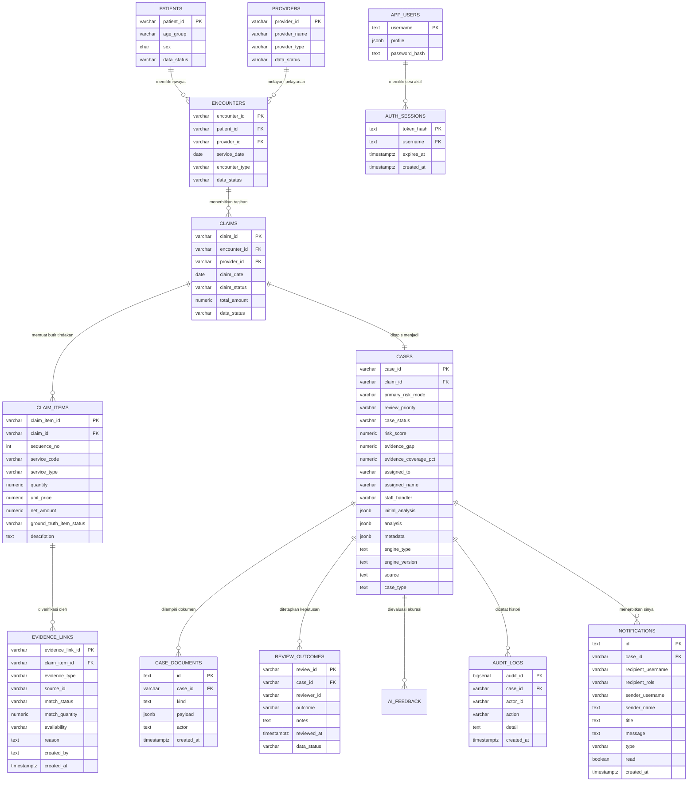
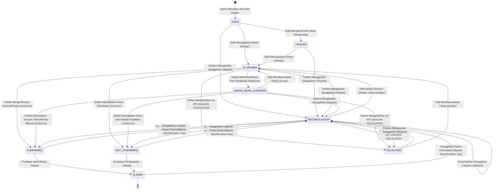

# ARSITEKTUR DATA, ENTITY RELATIONSHIP, DAN TRANSISI STATUS MEDCAREJKN

Dokumen ini menjelaskan rancangan arsitektur basis data, model relasi entitas (*Entity-Relationship Diagram*), mesin transisi status berkas klaim (*Finite State Machine*), serta formulasi matematis kalkulasi risiko integritas pada platform **medCareJKN** berdasarkan kode sumber aktif di `D:\medcare`.

---

## 1. DIAGRAM RELASI ENTITAS (ENTITY-RELATIONSHIP DIAGRAM)

> [!NOTE]
> **Keterangan Metode Verifikasi Diagram:** Pemeriksaan diagram Mermaid dalam dokumen ini dilakukan melalui inspeksi teks dan struktur blok kode Markdown. Karena utilitas parser Mermaid CLI (`mmdc`) tidak tersedia di komputer lokal Windows dan tidak dilakukan pemasangan dependensi baru, proses kompilasi/rendering diagram melalui parser belum diverifikasi secara terprogram. Keberhasilan rendering grafis tidak dapat dipastikan hanya berdasarkan inspeksi tanda kurung atau blok kode.

Arsitektur basis data relasional diimplementasikan pada PostgreSQL (`jkn_integrity`):



---

## 2. SPESIFIKASI DAN STRUKTUR TABEL DATABASE UTAMA

1. **`cases` (Tabel Kasus Audit Inti):**
   - Menyimpan seluruh berkas kasus klaim yang masuk ke dalam sistem.
   - Kolom status: `case_status` (`OPEN`, `TRIAGED`, `IN_REVIEW`, `NEEDS_MORE_EVIDENCE`, `RECONCILIATION`, `CONFIRMED`, `NOT_CONFIRMED`, `CLOSED`).
   - Kolom metrik: `risk_score` (0–100), `review_priority` (`HIGH`, `MEDIUM`, `LOW`, `NO_CONCLUSION`), `evidence_gap` (selisih kuantitas tindakan), `evidence_coverage_pct` (0–100%).
   - Kolom penanggung jawab: `assigned_to` (username dokter), `assigned_name` (nama dokter), `staff_handler` (username staf verifikator).
2. **`claims` & `claim_items`:**
   - Menyimpan header klaim dan rincian per butir tindakan (kode tarif, kuantitas tagih, harga satuan, dan total harga).
3. **`evidence_links`:**
   - Menghubungkan butir tagihan dengan bukti fisik rekam medis elektronik. Menandai status ketersediaan (`availability`: `YES` / `UNAVAILABLE`) dan pencocokan (`match_status`: `MATCHED` / `PENDING`).
4. **`review_outcomes`:**
   - Menyimpan putusan akhir telaah klinis dokter spesialis (`CONFIRMED`, `NOT_CONFIRMED`, `NEEDS_MORE_EVIDENCE`, `FALSE_POSITIVE`, `ESCALATED`) beserta catatan pertimbangan klinis dan stempel waktu server. Kolom `outcome` menyimpan nilai mentah enum yang dikirimkan.
5. **`notifications`:**
   - Menyimpan notifikasi terpartisi berdasarkan `recipient_username` dan `recipient_role` dengan flag `read`.
6. **`audit_logs`:**
   - Pencatatan seluruh histori transaksi dan mutasi status kasus secara kronologis.
7. **`rule_config_log`:**
   - Riwayat audit perubahan bobot aturan dan hash konfigurasi aturan (`config_hash`).
8. **`app_users` & `auth_sessions`:**
   - Mengelola akun terdaftar (`staff_jkn` dan `clinical_reviewer`) serta sesi token Bearer aktif dengan masa berlaku 8 jam.

---

## 3. FINITE STATE MACHINE (FSM) TRANSISI STATUS KASUS

> [!NOTE]
> **Keterangan Metode Verifikasi Diagram FSM:** Diagram *Finite State Machine* di bawah ini disusun sebagai visualisasi alur status dan diverifikasi secara struktural melalui penelaahan teks kode. Rendering grafis aktual via parser Mermaid belum diuji dengan kompilator parser lokal.



### Matriks Validasi Transisi Status di Backend:

| Status Saat Ini | Status Target | Endpoint API | Role Berwenang | Kondisi Prasyarat | Efek Samping Sistem |
|---|---|---|---|---|---|
| `OPEN` / `NEW` | `TRIAGED` | `POST /cases/:id/ownership` | `staff_jkn` (`requireRole`) | Sesi aktif | Kolom `staff_handler` terisi username staf. |
| `OPEN` / `TRIAGED` / `NEEDS_MORE_EVIDENCE` / `RECONCILIATION` / `ESCALATED` | `IN_REVIEW` | `POST /cases/:id/assign` | `staff_jkn` (`requireRole`) | Dokter valid dipilih. Kasus belum berstatus final. | `assigned_to` dan `assigned_name` terisi (mendukung pergantian reviewer), `case_status` menjadi `IN_REVIEW`, notifikasi terbit ke dokter target, audit log `ASSIGNED_TO_CLINICIAN` tercatat. |
| `IN_REVIEW` / `RECONCILIATION` / `NEEDS_MORE_EVIDENCE` | `CONFIRMED` | `POST /cases/:id/outcome` (Opsi UI: `CONFIRMED`) | `clinical_reviewer` (`requireRole`) | Dokter yang ditugaskan mengisi catatan klinis konfirmasi | Status kasus berubah ke `CONFIRMED`, nilai `CONFIRMED` tersimpan di `review_outcomes`, notifikasi terbit ke staf. |
| `IN_REVIEW` / `RECONCILIATION` / `NEEDS_MORE_EVIDENCE` | `NOT_CONFIRMED` | `POST /cases/:id/outcome` (Opsi UI: `NOT_CONFIRMED`) | `clinical_reviewer` (`requireRole`) | Dokter yang ditugaskan mengisi catatan klinis wajar | Status kasus berubah ke `NOT_CONFIRMED`, nilai `NOT_CONFIRMED` tersimpan di `review_outcomes`, notifikasi terbit ke staf. |
| `IN_REVIEW` / `RECONCILIATION` / `NEEDS_MORE_EVIDENCE` | `NOT_CONFIRMED` | `POST /cases/:id/outcome` (Opsi UI: `FALSE_POSITIVE`) | `clinical_reviewer` (`requireRole`) | Dokter mencatat anomali akibat kesalahan teknis sistem / aturan | Status kasus pada tabel `cases` berubah ke `NOT_CONFIRMED`, nilai mentah `FALSE_POSITIVE` tersimpan di `review_outcomes`, notifikasi terbit ke staf. |
| `IN_REVIEW` / `RECONCILIATION` / `NEEDS_MORE_EVIDENCE` | `NEEDS_MORE_EVIDENCE` | `POST /cases/:id/outcome` (Opsi UI: `NEEDS_MORE_EVIDENCE`) | `clinical_reviewer` (`requireRole`) | Dokter meminta dokumen fisik tambahan resmi | Status kasus berubah ke `NEEDS_MORE_EVIDENCE`, tercatat di `review_outcomes`, notifikasi terbit ke staf. |
| `OPEN` / `NEW` / `TRIAGED` / `IN_REVIEW` / `NEEDS_MORE_EVIDENCE` / `ESCALATED` | `RECONCILIATION` | `POST /cases/:id/dispute` | `staff_jkn` (`requireRole` & Service Check) | Judul sanggahan dan berkas faskes terisi. Kasus belum berstatus final. | Kolom `case_status` diperbarui menjadi `RECONCILIATION`, dokumen dicatat ke `case_documents`, kalkulasi ulang risiko, notifikasi diterbitkan ke staf dan dokter. |
| `RECONCILIATION` | `RECONCILIATION` (Tetap) | `POST /cases/:id/dispute` | `staff_jkn` (`requireRole` & Service Check) | Judul sanggahan dan berkas faskes tambahan terisi | Dokumen sanggahan susulan dicatat ke `case_documents`, kalkulasi ulang risiko, status kasus tetap `RECONCILIATION`. |
| `CONFIRMED` / `NOT_CONFIRMED` / `CLOSED` | `RECONCILIATION` | `POST /cases/:id/dispute` | `staff_jkn` (`requireRole` & Service Check) | Pengiriman parameter `allowRevision: true` oleh Staff JKN yang sah | Membuka kembali berkas yang terkunci untuk peninjauan sanggahan baru, status bertransisi ke `RECONCILIATION`. |
| `NEEDS_MORE_EVIDENCE` / `RECONCILIATION` | Status Kasus Tetap (Bukti Diperbarui) | `POST /cases/:id/evidence` | Sesi Terautentikasi (`requireSession`) | Berkas valid diunggah | Dokumen terarsip, tautan bukti dibuat, cakupan bukti (*evidence coverage*) dihitung ulang. |
| `IN_REVIEW` / `RECONCILIATION` / `NEEDS_MORE_EVIDENCE` | `ESCALATED` | `POST /cases/:id/outcome` (Direct API) | `clinical_reviewer` (`requireRole`) | Parameter `{ outcome: 'ESCALATED', notes: '...' }` dikirim via panggilan API langsung | Status bertransisi ke `ESCALATED`, tersimpan di `review_outcomes`, notifikasi diterbitkan ke `staff_jkn`. |

### Tabel Komparasi 3-Lapis Outcome Telaah Klinis (UI vs Backend API vs Status Kasus Database)

Berdasarkan validasi pada `submitCaseOutcome` di [backend/src/services/caseService.js](file:///D:/medcare/backend/src/services/caseService.js#L243-L274) dan formulir telaah klinis pada [frontend/src/pages/CaseDetailPage.jsx](file:///D:/medcare/frontend/src/pages/CaseDetailPage.jsx#L1428-L1433), terdapat perbedaan tegas antara pilihan pada antarmuka pengguna, nilai enum yang diterima API backend, dan status kasus akhir pada basis data:

| Pilihan Kartu pada UI (`CaseDetailPage.jsx`) | Nilai Diterima API Backend (`outcome`) | Disimpan di Kolom `review_outcomes.outcome` | Status Akhir pada Kolom `cases.case_status` | Keterangan & Dampak Status |
|---|---|---|---|---|
| `CONFIRMED` ("Temuan terkonfirmasi oleh reviewer") | `CONFIRMED` | `CONFIRMED` | `CONFIRMED` | Temuan anomali/fraud terkonfirmasi secara klinis. Berkas berstatus final. |
| `NOT_CONFIRMED` ("Klaim Wajar (Valid)") | `NOT_CONFIRMED` | `NOT_CONFIRMED` | `NOT_CONFIRMED` | Klaim dinyatakan wajar/sah secara medis. Berkas berstatus final. |
| `FALSE_POSITIVE` ("False Positive") | `FALSE_POSITIVE` | `FALSE_POSITIVE` | `NOT_CONFIRMED` | **PENTING:** Backend menerima nilai mentah `FALSE_POSITIVE` dan menyimpannya ke tabel `review_outcomes`, namun memetakan status akhir pada tabel `cases.case_status` menjadi `NOT_CONFIRMED` (lihat baris 262-264 `caseService.js`). Berkas berstatus final. |
| `NEEDS_MORE_EVIDENCE` ("Perlu Konfirmasi Berkas") | `NEEDS_MORE_EVIDENCE` | `NEEDS_MORE_EVIDENCE` | `NEEDS_MORE_EVIDENCE` | Berkas fisik rekam medis belum mencukupi; dokter meminta konfirmasi bukti fisik resmi dari Faskes. |
| *(Tidak tersedia opsi kartu pada UI form dokter)* | `ESCALATED` | `ESCALATED` | `ESCALATED` | Eskalasi berkas ke telaah lanjutan. Diterima oleh backend API dan tersedia sebagai pilihan filter pada antrean kasus (`CasesPage.jsx`). |

> [!NOTE]
> **Resolusi Temuan Keamanan Otorisasi Endpoint Dispute (SEC-01 — RESOLVED & VERIFIED):**
> 1. **Perlindungan Berlapis Tingkat Route & Service:**
>    - Pada [backend/src/routes/caseRoutes.js](file:///D:/medcare/backend/src/routes/caseRoutes.js#L18), endpoint `POST /api/cases/:caseId/dispute` secara resmi dilindungi oleh middleware `requireRole('staff_jkn')`.
>    - Pada [backend/src/services/caseService.js](file:///D:/medcare/backend/src/services/caseService.js#L368), method `recordCaseAction('dispute')` menerapkan otorisasi tingkat service (*defense in depth*) dengan memvalidasi `actor?.role === 'staff_jkn'` sebelum memeriksa status kasus atau parameter revisi.
> 2. **Penguncian Ketat & Perlindungan `allowRevision`:** Parameter `allowRevision: true` dikunci secara teknis HANYA untuk `kind === 'dispute'` oleh aktor dengan peran `staff_jkn`. Action lain (`evidence`, `clarification`, `schedule`, `ownership`, `outcome`) yang dikirimkan pada kasus final akan selalu ditolak dengan HTTP 409 sekalipun menyertakan `allowRevision: true`. Selain itu, karena pengecekan role dieksekusi sebelum evaluasi status kasus pada alur dispute, aktor di luar `staff_jkn` (seperti `clinical_reviewer`) yang mencoba mengirim `{ allowRevision: true }` ditolak seketika dengan HTTP 403, mencegah pembukaan kembali kasus final secara tidak sah.
> 3. **Konsistensi Frontend:** Tombol dan modal sanggahan pada `CaseDetailPage.jsx` hanya ditampilkan bagi akun dengan role `staff_jkn`. Parameter `allowRevision` juga telah dibersihkan dari submit outcome dan unggah bukti pendukung.
> 4. **Verifikasi Test Suite & Isolasi Database:** Seluruh skenario keamanan diverifikasi lulus 100% pada suite pengujian otomatis `security.dispute.test.js` dengan database uji terisolasi dan fixture reset antar skenario tanpa memutasi basis data operasional `jkn_integrity`.

> [!NOTE]
> **Klarifikasi Identitas Aktor, Pihak yang Diwakili, dan Keterbatasan Penyimpanan Sanggahan:**
> Dalam proses rekonsiliasi sanggahan Faskes, terdapat pembedaan tegas antara tiga entitas:
> 1. **Pihak yang Diwakili (*Represented Entity*):** Fasilitas Kesehatan (Rumah Sakit / Komite Medik RS). Faskes **tidak memiliki akun pengguna mandiri maupun portal login independen** ke dalam aplikasi MedCareJKN.
> 2. **Pengguna Pencatat (*Recording User*):** Staff JKN internal yang sedang login memegang sesi aktif, yang menginput surat sanggahan fisik/email dari Faskes ke dalam sistem melalui Seksi 7B `CaseDetailPage.jsx`.
> 3. **Dokter Penelaah (*Clinical Reviewer*):** DPJP yang ditugaskan untuk menelaah kesesuaian medis atas sanggahan tersebut.
> 
> *Penelusuran Alur Data & Penyimpanan Basis Data:*
> - **Frontend Payload ([CaseDetailPage.jsx](file:///D:/medcare/frontend/src/pages/CaseDetailPage.jsx#L336-L343)):** Form sanggahan mengirim objek:
>   `actor: disputeActor || (currentUser?.role === 'clinical_reviewer' ? currentUser.name : 'Komite Medik ' + providerName)`
>   `role: currentUser?.role === 'clinical_reviewer' ? 'Dokter Penelaah Medis (DPJP)' : 'Fasilitas Kesehatan (Rumah Sakit)'`
> - **Penyimpanan di Backend ([caseService.js](file:///D:/medcare/backend/src/services/caseService.js#L389-L404)):**
>   - Tabel `case_documents`: Kolom `actor` diisi username sesi aktif (`actor.username`, misal `staff.ahmad`). Objek payload lengkap disimpan sebagai JSON pada kolom `payload`.
>   - Tabel `audit_logs`: Kolom `actor_id` diisi `actor.username` (staf pencatat), dan JSON gabungan `{ actorName: actor.name, ...payload }` disimpan pada kolom `detail`.
>   - Tabel `notifications`: Kolom `senderUsername` diisi `actor.username` (staf pencatat), sedangkan pesan teks menampilkan `${payload.actor || ...}`.
> - **Penimpaan pada API `getCaseDetail` (baris 217):** Saat menyajikan data sanggahan, backend menjalankan:
>   `disputes: docs.filter(...).map(d => ({ ...d.payload, id: d.id, actor: d.actor, ... }))`
>   Karena `actor: d.actor` ditulis setelah `...d.payload`, nilai `actor` pada respons API tertimpa oleh `d.actor` (username staf, misal `staff.ahmad`). Akibatnya, pada tampilan UI Bagian 7B, nama yang tampil di sebelah badge adalah nama staf pencatat (`dsp.actor`), sedangkan badge menampilkan role `'Fasilitas Kesehatan (Rumah Sakit)'` dari `dsp.role`.
> - **Keterbatasan Implementasi (*Implementation Limitation*):** Skema data saat ini belum memisahkan kolom identitas pengguna yang mencatat (*recorded_by_user*) dengan entitas eksternal yang diwakili (*representing_entity*). Identitas Faskes hanya menumpang sebagai teks dalam blob JSON `payload`. Keterbatasan ini dicatat dalam dokumentasi tanpa memodifikasi kode sumber.

> [!NOTE]
> **Pembedaan Ketentuan SOP Medis vs Validasi Teknis Backend pada Kasus `RECONCILIATION`:**
> 1. **Pemeriksaan yang Diwajibkan oleh Kode Backend:** Pada [backend/src/services/caseService.js](file:///D:/medcare/backend/src/services/caseService.js#L240-L245) (`submitCaseOutcome`), backend **HANYA memvalidasi**:
>    - Berkas kasus ditugaskan kepada dokter pemanggil (`currentCase.assigned_to === reviewerId`).
>    - Catatan pertimbangan klinis tidak kosong (`notes?.trim()`).
>    - Status kasus tidak berada di status final (`CONFIRMED`, `NOT_CONFIRMED`, `CLOSED`) (kasus berstatus final ditolak langsung dengan HTTP 409).
>    Backend **TIDAK memvalidasi secara teknis**: apakah ada dokumen sanggahan baru yang tercatat, apakah ada penambahan bukti fisik baru, atau apakah dokter telah membaca dokumen sanggahan faskes.
> 2. **Ketentuan Standar Operasional Prosedur (SOP) Dokter:** Secara tata kelola medis dan etika audit, Dokter Penelaah diwajibkan membaca berkas klarifikasi rumah sakit pada Seksi 7B sebelum menetapkan keputusan ulang. Namun hal ini merupakan **kepatuhan SOP profesi**, **bukan restriksi programatik yang dipaksakan oleh sistem backend**.

> [!IMPORTANT]
> **Ketiadaan Timer / Cron Otomatis pada `NEEDS_MORE_EVIDENCE`:**
> Backend MedCareJKN **TIDAK memiliki timer otomatis, background worker, atau cron job** untuk melakukan kedaluwarsa (*auto-expire*) atau konfirmasi otomatis (*auto-confirm*). Seluruh perubahan status dari `NEEDS_MORE_EVIDENCE` menuju `CONFIRMED` atau `NOT_CONFIRMED` **hanya terjadi melalui aksi manual Dokter Penelaah Klinis** (`POST /cases/:id/outcome`) setelah mengevaluasi ketersediaan dan keabsahan dokumen rekam medis. Prinsip bisnis tetap dijaga: ketiadaan dokumen adalah kesenjangan bukti medis, bukan vonis otomatis kecurangan (*fraud*) tanpa telaah klinis.

> [!NOTE]
> **Status `ESCALATED` (Hasil Rekonsiliasi Backend vs Antarmuka Pengguna):**
> `ESCALATED` didukung sebagai nilai outcome pada backend API, tetapi tidak tersedia sebagai pilihan keputusan pada form telaah klinis di CaseDetailPage. Status `ESCALATED` tetap tersedia sebagai pilihan filter pada halaman antrean kasus.
> 
> *Rincian Pemeriksaan Teknis:*
> 1. **Dukungan Backend API Aktif:** Endpoint `POST /api/cases/:id/outcome` dilindungi oleh middleware autentikasi `requireSession` (Header `Authorization: Bearer <token>`) dan otorisasi role `requireRole('clinical_reviewer')` pada [backend/src/routes/caseRoutes.js](file:///D:/medcare/backend/src/routes/caseRoutes.js#L14). Di service [backend/src/services/caseService.js](file:///D:/medcare/backend/src/services/caseService.js#L242-L273), pemanggil wajib merupakan dokter yang ditugaskan pada kasus tersebut (`currentCase.assigned_to === reviewerId`). Fungsi menerima `outcome: 'ESCALATED'`, menyimpan baris `'ESCALATED'` pada tabel `review_outcomes`, dan memutasi `case_status` menjadi `'ESCALATED'`.
> 2. **Kontrol Form Telaah Klinis Dokter:** Pada antarmuka peramban [frontend/src/pages/CaseDetailPage.jsx](file:///D:/medcare/frontend/src/pages/CaseDetailPage.jsx#L1428-L1433), form putusan dokter hanya merender 4 kartu pilihan keputusan (`NEEDS_MORE_EVIDENCE`, `CONFIRMED`, `NOT_CONFIRMED`, `FALSE_POSITIVE`). Tidak tersedia kartu radio atau tombol submit untuk `ESCALATED`.
> 3. **Filter Antrean Kasus:** Pada [frontend/src/pages/CasesPage.jsx](file:///D:/medcare/frontend/src/pages/CasesPage.jsx#L376), filter status menyediakan opsi `<option value="ESCALATED">ESCALATED</option>` untuk menyaring berkas jika ada data yang berstatus tersebut.
> 4. **Jalur Struktural Transisi Lanjutan:**
>    - **Penugasan Ulang (`ESCALATED --> IN_REVIEW`):** Didukung secara struktural di `assignCaseReviewer` (baris 320-335) via `POST /api/cases/:id/assign` dengan middleware `requireRole('staff_jkn')`. Staf dapat mendisposisikan kembali kasus (termasuk mengganti dokter reviewer target), memutasi status ke `IN_REVIEW`, mencatat log audit `ASSIGNED_TO_CLINICIAN`, dan menerbitkan notifikasi penugasan ke dokter target.
>    - **Sanggahan Faskes (`ESCALATED --> RECONCILIATION`):** Didukung secara struktural di `recordCaseAction` (baris 368-390) via `POST /api/cases/:id/dispute`, karena `ESCALATED` tidak termasuk dalam guard status final `['CONFIRMED','NOT_CONFIRMED','CLOSED']`.
>    - **Catatan Kalibrasi Pengujian:** Kedua jalur lanjutan dari status `ESCALATED` ini merupakan **jalur yang didukung secara struktural oleh kode**, namun **belum pernah diuji secara runtime** karena dataset demo inisialisasi tidak memiliki kasus berstatus awal `ESCALATED`.

> [!NOTE]
> **Status `NEW` pada Basis Data:**
> Status `NEW` bukan sekadar alias atau sisa kode lama, melainkan status aktif yang digunakan khusus untuk kasus pola agregat anomali (`case_type = 'pattern'`) yang diinisialisasi melalui endpoint `POST /anomalies/cases` pada [backend/src/routes/bpjsRoutes.js](file:///D:/medcare/backend/src/routes/bpjsRoutes.js#L12). Ketika Staff JKN mengambil alih kasus ini via `POST /cases/:id/ownership`, status bertransisi dari `NEW` menjadi `TRIAGED`. Kolom `cases.case_status` di PostgreSQL berjenis `VARCHAR(30) NOT NULL DEFAULT 'OPEN'` tanpa CHECK constraint atau enum pembatas.

---

## 4. FORMULASI MATEMATIS RULE & RISK ENGINE (`rules-1.0.0`)

Berdasarkan implementasi kode pada [shared/riskEngine.js](file:///D:/medcare/shared/riskEngine.js), [config/risk_rules.json](file:///D:/medcare/config/risk_rules.json), dan [shared/caseContract.js](file:///D:/medcare/shared/caseContract.js):

### A. Ketersediaan Bukti (*Evidence Known*):
$$\text{evidenceKnown} = (\text{evidenceAvailable} = \text{true}) \land (\text{claimedQty} \neq \text{null}) \land (\text{supportedQty} \neq \text{null})$$

### B. Kuantitas Tindakan Terdukung (*Supported Quantity*) & Anti-Inflasi Dokumen:
Untuk mencegah duplikasi berkas melipatgandakan klaim, satu item tindakan yang dilampiri banyak dokumen hanya mengambil nilai kuantitas maksimum dari **satu dokumen terverifikasi yang cocok**:
$$\text{supportedQuantity} = \min\left(\text{claimedQuantity}, \max(0, \dots \text{matchedDocs.quantity})\right)$$

### C. Rasio Cakupan Bukti Medis (*Evidence Coverage Percentage*):
$$\text{evidenceCoveragePct} = \begin{cases} 
\min\left(100, \text{round}\left(\frac{\text{supportedQty}}{\max(1, \text{claimedQty})} \times 100\right)\right), & \text{jika } \text{evidenceKnown} \\ 
\text{null}, & \text{jika } \neg\text{evidenceKnown} 
\end{cases}$$

### D. Selisih Bukti Fisik (*Evidence Gap* - Satuan Kuantitas Item):
$$\text{evidenceGap} = \begin{cases} 
\max(0, \text{claimedQty} - \text{supportedQty}), & \text{jika } \text{evidenceKnown} \\ 
\text{null}, & \text{jika } \neg\text{evidenceKnown} 
\end{cases}$$

### E. Skor Risiko Kuantitatif (*Risk Score*):
Skor risiko dihitung dari penjumlahan bobot aturan yang terpicu (*explainable rule weight sum*), dibatasi maksimal 100:
$$\text{riskScore} = \min\left(100, \sum_{s \in \text{signals}} \text{rawWeight}_s\right)$$

Jika total bobot melebihi 100, kontribusi masing-masing aturan dinormalisasi secara proporsional:
$$\text{contribution}_s = \begin{cases} 
\text{rawWeight}_s \times \frac{100}{\sum \text{rawWeight}}, & \text{jika } \sum \text{rawWeight} > 100 \\ 
\text{rawWeight}_s, & \text{jika } \sum \text{rawWeight} \le 100 
\end{cases}$$

#### Daftar 6 Aturan Aktif (`config/risk_rules.json`):
1. **`PB-01` (Phantom Billing):** `unsupportedQuantity > 0`, Bobot: **65**. Pemicu: bukti ada namun kuantitas tertagih melebihi bukti layanan.
2. **`UC-01` (Upcoding):** `tariffGap > 0`, Bobot: **35**. Pemicu: selisih tarif terhadap pembanding terverifikasi.
3. **`UP-01` (Unnecessary Procedures):** `procedureIndication == false`, Bobot: **45**. Pemicu: ketidaksesuaian indikasi medis tercatat eksplisit.
4. **`DC-01` (Duplicate Claim):** `duplicateCount > 1`, Bobot: **55**. Pemicu: klaim serupa melebihi 1 pada kelompok pembanding yang sama.
5. **`WD-01` (Wrong Diagnosis):** `diagnosisProcedureMatch == false`, Bobot: **45**. Pemicu: ketidaksesuaian diagnosis dan prosedur dari telaah eksplisit.
6. **`GE-01` (Ghost Enrollee):** `enrollmentValid == false`, Bobot: **40**. Pemicu: status peserta tidak valid.

### F. Urutan Evaluasi Kondisi & Pemetaan Prioritas Telaah (*Review Priority*):
Berdasarkan baris 13-14 pada `shared/riskEngine.js`, urutan evaluasi kondisi berjalan sebagai berikut:

```
JIKA signals kosong DAN evidenceKnown == false MAKA
    signals.push(id: 'EVIDENCE-MISSING', label: 'Bukti belum tersedia untuk disimpulkan', nextAction: 'Minta bukti layanan, tanpa menyimpulkan fraud')

reviewPriority =
    JIKA riskScore >= 60 MAKA 'HIGH'
    LAIN JIKA riskScore >= 30 MAKA 'MEDIUM'
    LAIN JIKA evidenceKnown == false MAKA 'NO_CONCLUSION'
    LAINNYA 'LOW'

riskLevel =
    JIKA riskScore >= 60 MAKA 'HIGH'
    LAIN JIKA riskScore >= 30 MAKA 'MEDIUM'
    LAIN JIKA evidenceKnown == false MAKA 'UNAVAILABLE'
    LAINNYA 'LOW'
```

> [!IMPORTANT]
> **Penjelasan Faktual Skenario Ketiadaan Bukti:** Pada berkas kasus di mana dokumen pendukung belum tercatat (`evidenceAvailable !== true`), aturan `PB-01` tidak terpicu karena `unsupportedQuantity` bernilai `null`. Jika tidak ada aturan lain yang terpicu, `riskScore` bernilai `0`. Karena kondisi `riskScore >= 60` dan `riskScore >= 30` bernilai salah, sistem memeriksa kondisi ketiga: `!evidenceKnown`, sehingga prioritas kasus ditetapkan sebagai **`NO_CONCLUSION`** dan level risiko sebagai **`UNAVAILABLE`**. Fakta ini membuktikan bahwa algoritma MedCareJKN **tidak menyimpulkan ketiadaan berkas sebagai vonis kecurangan (fraud)**.

---

## 5. ASAL-USUL DATASET & ISOLASI KOHORT (*DATA PROVENANCE*)

1. **Kasus Demo Sintetis (`data/demo/cases.json`):**
   - Berisi 8 kasus skenario sintetis terkalibrasi (`CASE-PB-001` s/d `CASE-PB-008`).
   - Disimpan di tabel `cases` PostgreSQL dengan `source = 'seed'` dan `data_status = 'SYNTHETIC'`.
2. **Evaluasi Benchmark Sintetis (`data/benchmark/`):**
   - File `synthetic.json` (800 skenario: 560 train / 240 test) dievaluasi oleh `validation_report.json`.
   - Peringatan resmi dokumen: *"Label berasal dari skenario sintetis. Tidak mencerminkan akurasi deteksi fraud pada data JKN nyata."* Sistem tidak melakukan fitting model ML (*trainingUsed: false*).
3. **Sampel Kohort BPJS 2025 (`outputs/bpjs-2025/`):**
   - Sampel data kontekstual COVID edisi 2025 yang telah dide-identifikasi.
   - Disimpan dalam file agregat `analysis.json` dan SQLite lokal `bpjs-patients.sqlite`.
   - Hanya diakses secara *read-only* untuk pratinjau katalog dan distribusi data pada menu *Data BPJS*.
4. **Audit Simulasi Pasien BPJS (`outputs/bpjs-simulation/audit.sqlite`):**
   - Basis data SQLite lokal independen yang digunakan untuk merekam riwayat simulasi audit prospektif pasien BPJS.
