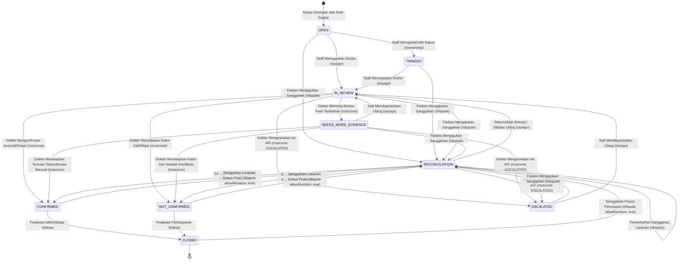

# ARSITEKTUR DATA, ENTITY RELATIONSHIP, DAN TRANSISI STATUS MEDCAREJKN

Dokumen ini menjelaskan rancangan arsitektur basis data, model relasi entitas (*Entity-Relationship Diagram*), mesin transisi status berkas klaim (*Finite State Machine*), pemblokiran endpoint modul legacy pada lingkungan operasional, serta formulasi matematis kalkulasi risiko integritas pada platform **medCareJKN** berdasarkan kode sumber aktif di `D:\medcare` per **30 Oktober 2026**.

---

## 1. DIAGRAM RELASI ENTITAS (ENTITY-RELATIONSHIP DIAGRAM)

> [!NOTE]
> **Keterangan Metode Verifikasi Diagram:** Pemeriksaan diagram Mermaid dalam dokumen ini dilakukan melalui inspeksi teks dan struktur blok kode Markdown. Karena utilitas parser Mermaid CLI (`mmdc`) tidak tersedia di komputer lokal Windows dan tidak dilakukan pemasangan dependensi baru, proses kompilasi/rendering diagram melalui parser belum diverifikasi secara terprogram. Keberhasilan rendering grafis tidak dapat dipastikan hanya berdasarkan inspeksi tanda kurung atau blok kode.

Arsitektur basis data relasional diimplementasikan pada PostgreSQL (`jkn_integrity`):


---

## 2. SPESIFIKASI DAN STRUKTUR TABEL DATABASE UTAMA

1. **`cases` (Tabel Kasus Audit Inti):**
   - Menyimpan seluruh berkas kasus klaim yang masuk ke dalam sistem.
   - Kolom status: `case_status` (`OPEN`, `TRIAGED`, `IN_REVIEW`, `NEEDS_MORE_EVIDENCE`, `RECONCILIATION`, `CONFIRMED`, `NOT_CONFIRMED`, `CLOSED`).
   - Kolom metrik: `risk_score` (0–100), `review_priority` (`HIGH`, `MEDIUM`, `LOW`, `NO_CONCLUSION`), `evidence_gap` (selisih kuantitas tindakan), `evidence_coverage_pct` (0–100%).
   - Kolom penanggung jawab: `assigned_to` (username dokter), `assigned_name` (nama dokter), `staff_handler` (username staf verifikator).
   - Kolom klasifikasi domain: `primary_risk_mode` (`PHANTOM_BILLING`, `UPCODING`, `EVIDENCE_REVIEW`, `UNAVAILABLE`).
2. **`claims` & `claim_items`:**
   - Menyimpan header klaim dan rincian per butir tindakan (kode tarif, kuantitas tagih, harga satuan, dan total harga).
3. **`evidence_links`:**
   - Menghubungkan butir tagihan dengan bukti fisik rekam medis elektronik. Menandai status ketersediaan (`availability`: `YES` / `UNAVAILABLE`) dan pencocokan (`match_status`: `MATCHED` / `PENDING`).
4. **`review_outcomes`:**
   - Menyimpan putusan akhir telaah klinis dokter spesialis (`CONFIRMED`, `NOT_CONFIRMED`, `NEEDS_MORE_EVIDENCE`, `FALSE_POSITIVE`, `ESCALATED`) beserta catatan pertimbangan klinis dan stempel waktu server. Kolom `outcome` menyimpan nilai mentah enum yang dikirimkan.
5. **`notifications`:**
   - Menyimpan notifikasi terpartisi berdasarkan `recipient_username` (personal dokter) dan `recipient_role` (staf/role-wide) dengan flag `read`.
6. **`audit_logs`:**
   - Pencatatan seluruh histori transaksi dan mutasi status kasus secara kronologis.
7. **`rule_config_log`:**
   - Riwayat audit konfigurasi aturan (`config_hash`).
8. **`app_users` & `auth_sessions`:**
   - Mengelola akun terdaftar (`staff_jkn` dan `clinical_reviewer`) serta sesi token Bearer aktif dengan masa berlaku 8 jam.

---

## 3. FINITE STATE MACHINE (FSM) TRANSISI STATUS KASUS

> [!NOTE]
> **Keterangan Metode Verifikasi Diagram FSM:** Diagram *Finite State Machine* di bawah ini disusun sebagai visualisasi alur status dan diverifikasi secara struktural melalui penelaahan teks kode. Rendering grafis aktual via parser Mermaid belum diuji dengan kompilator parser lokal.



### Matriks Validasi Transisi Status di Backend:

| Status Saat Ini | Status Target | Endpoint API | Role Berwenang | Kondisi Prasyarat | Efek Samping Sistem |
|---|---|---|---|---|---|
| `OPEN` / `NEW` | `TRIAGED` | `POST /cases/:id/ownership` | `staff_jkn` (`requireRole`) | Sesi aktif | Kolom `staff_handler` terisi username staf. |
| `OPEN` / `TRIAGED` / `NEEDS_MORE_EVIDENCE` / `RECONCILIATION` / `ESCALATED` | `IN_REVIEW` | `POST /cases/:id/assign` | `staff_jkn` (`requireRole`) | Dokter valid dipilih. Kasus belum berstatus final. | `assigned_to` dan `assigned_name` terisi (mendukung pergantian reviewer), `case_status` menjadi `IN_REVIEW`, notifikasi terbit ke dokter target, audit log `ASSIGNED_TO_CLINICIAN` tercatat. |
| `IN_REVIEW` / `RECONCILIATION` / `NEEDS_MORE_EVIDENCE` | `CONFIRMED` | `POST /cases/:id/outcome` (Opsi UI: `CONFIRMED`) | `clinical_reviewer` (`requireRole`) | Dokter yang ditugaskan mengisi catatan klinis konfirmasi | Status kasus berubah ke `CONFIRMED`, nilai `CONFIRMED` tersimpan di `review_outcomes`, notifikasi terbit ke staf. |
| `IN_REVIEW` / `RECONCILIATION` / `NEEDS_MORE_EVIDENCE` | `NOT_CONFIRMED` | `POST /cases/:id/outcome` (Opsi UI: `NOT_CONFIRMED`) | `clinical_reviewer` (`requireRole`) | Dokter yang ditugaskan mengisi catatan klinis wajar | Status kasus berubah ke `NOT_CONFIRMED`, nilai `NOT_CONFIRMED` tersimpan di `review_outcomes`, notifikasi terbit ke staf. |
| `IN_REVIEW` / `RECONCILIATION` / `NEEDS_MORE_EVIDENCE` | `NOT_CONFIRMED` | `POST /cases/:id/outcome` (Opsi UI: `FALSE_POSITIVE`) | `clinical_reviewer` (`requireRole`) | Dokter mencatat anomali akibat kesalahan teknis sistem / aturan | Status kasus pada tabel `cases` berubah ke `NOT_CONFIRMED`, nilai mentah `FALSE_POSITIVE` tersimpan di `review_outcomes`, notifikasi terbit ke staf. |
| `IN_REVIEW` / `RECONCILIATION` / `NEEDS_MORE_EVIDENCE` | `NEEDS_MORE_EVIDENCE` | `POST /cases/:id/outcome` (Opsi UI: `NEEDS_MORE_EVIDENCE`) | `clinical_reviewer` (`requireRole`) | Dokter meminta dokumen fisik tambahan resmi | Status kasus berubah ke `NEEDS_MORE_EVIDENCE`, tercatat di `review_outcomes`, notifikasi terbit ke staf. |
| `OPEN` / `NEW` / `TRIAGED` / `IN_REVIEW` / `NEEDS_MORE_EVIDENCE` / `ESCALATED` | `RECONCILIATION` | `POST /cases/:id/dispute` | `staff_jkn` (`requireRole` & Service Check) | Judul sanggahan dan berkas faskes terisi. Kasus belum berstatus final. | Kolom `case_status` diperbarui menjadi `RECONCILIATION`, dokumen dicatat ke `case_documents`, kalkulasi ulang risiko, notifikasi diterbitkan ke staf dan dokter. |
| `RECONCILIATION` | `RECONCILIATION` (Tetap) | `POST /cases/:id/dispute` | `staff_jkn` (`requireRole` & Service Check) | Judul sanggahan dan berkas faskes tambahan terisi | Dokumen sanggahan susulan dicatat ke `case_documents`, kalkulasi ulang risiko, status kasus tetap `RECONCILIATION`. |
| `CONFIRMED` / `NOT_CONFIRMED` / `CLOSED` | `RECONCILIATION` | `POST /cases/:id/dispute` | `staff_jkn` (`requireRole` & Service Check) | Pengiriman parameter `allowRevision === true` (strict boolean) oleh Staff JKN yang sah | Membuka kembali berkas yang terkunci untuk peninjauan sanggahan baru, status bertransisi ke `RECONCILIATION`. |
| `NEEDS_MORE_EVIDENCE` / `RECONCILIATION` | Status Kasus Tetap (Bukti Diperbarui) | `POST /cases/:id/evidence` | Sesi Terautentikasi (`requireSession`) | Berkas valid diunggah | Dokumen terarsip, tautan bukti dibuat, cakupan bukti (*evidence coverage*) dihitung ulang. |
| `IN_REVIEW` / `RECONCILIATION` / `NEEDS_MORE_EVIDENCE` | `ESCALATED` | `POST /cases/:id/outcome` (Direct API) | `clinical_reviewer` (`requireRole`) | Parameter `{ outcome: 'ESCALATED', notes: '...' }` dikirim via panggilan API langsung | Status bertransisi ke `ESCALATED`, tersimpan di `review_outcomes`, notifikasi diterbitkan ke `staff_jkn`. |

---

## 4. FORMULASI MATEMATIS TIGA FOKUS UTAMA & RISK ENGINE

Aplikasi MedCareJKN difokuskan secara eksklusif pada **tiga domain fungsional**:
1. **Phantom Billing (PB-01):** Deteksi selisih klaim tindakan tanpa bukti layanan pendukung.
2. **Upcoding (UC-01):** Deteksi selisih disparitas tarif tagihan melebihi tarif acuan standar INA-CBG.
3. **Evidence Review (Rekonsiliasi Deterministik):** Mesin rekonsiliasi bukti `reconcileItem()` (`shared/evidenceReconciliation.js`), bukan aturan fraud mandiri, tidak menambahkan skor risiko artifisial (skor 0).

### A. Ketersediaan Bukti (*Evidence Known*):
$$\text{evidenceKnown} = (\text{evidenceAvailable} = \text{true}) \land (\text{claimedQty} \neq \text{null}) \land (\text{supportedQty} \neq \text{null})$$

### B. Kuantitas Tindakan Terdukung (*Supported Quantity*) & Anti-Inflasi Dokumen:
Satu item tindakan yang dilampiri banyak dokumen hanya mengambil nilai kuantitas maksimum dari satu dokumen terverifikasi yang cocok:
$$\text{supportedQuantity} = \min\left(\text{claimedQuantity}, \max(0, \dots \text{matchedDocs.quantity})\right)$$

### C. Rasio Cakupan Bukti Medis (*Evidence Coverage Percentage*):
$$\text{evidenceCoveragePct} = \begin{cases} 
\min\left(100, \text{round}\left(\frac{\text{supportedQty}}{\max(1, \text{claimedQty})} \times 100\right)\right), & \text{jika } \text{evidenceKnown} \\ 
0, & \text{jika } \neg\text{evidenceKnown} 
\end{cases}$$

### D. Selisih Bukti Fisik (*Evidence Gap* - Satuan Kuantitas Item):
$$\text{evidenceGap} = \begin{cases} 
\max(0, \text{claimedQty} - \text{supportedQty}), & \text{jika } \text{evidenceKnown} \\ 
\text{null}, & \text{jika } \neg\text{evidenceKnown} 
\end{cases}$$

### E. Skor Risiko Kuantitatif (*Risk Score*):
Skor risiko dihitung dari penjumlahan bobot aturan yang terpicu (*explainable rule weight sum*), dibatasi maksimal 100:
$$\text{riskScore} = \min\left(100, \sum_{s \in \text{signals}} \text{rawWeight}_s\right)$$

#### Aturan Aktif Tiga Fokus (`config/risk_rules.json`):
1. **`PB-01` (Phantom Billing):** `unsupportedQuantity > 0`, Bobot: **65**. Pemicu: bukti ada namun kuantitas tertagih melebihi bukti layanan fisik yang terverifikasi.
2. **`UC-01` (Upcoding):** `tariffGap > 0`, Bobot: **35**. Pemicu: selisih nominal tagihan terhadap tarif acuan resmi INA-CBG ($\text{amountBilled} - \text{referenceTariff} > 0$).
3. **`Evidence Review` (Rekonsiliasi Deterministik):** Menggunakan `reconcileItem()`. Memberikan analisis kecocokan bukti secara objektif tanpa menambah bobot kecurangan (Bobot: **0**).

*(Aturan legacy lain seperti `UP-01`, `DC-01`, `WD-01`, `GE-01` dipertahankan dalam konfigurasi JSON untuk kompatibilitas skema tanpa mengubah bobot, namun alur operasional ditargetkan hanya pada ketiga domain utama di atas).*

### F. Penanganan Khusus Status `UNAVAILABLE` (*Missing Evidence*):
Pada berkas kasus di mana ketersediaan bukti ditandai belum tersedia (`evidenceAvailable === false`):
1. **Aturan PB-01 Tidak Terpicu:** Aturan `PB-01` mensyaratkan `evidenceKnown == true`. Ketika bukti belum ada, `unsupportedQuantity` bernilai `null` sehingga PB-01 tidak memicu penalti fraud.
2. **Skor Risiko Nol:** `risk_score = 0`.
3. **Prioritas Telaah:** Ditetapkan sebagai **`review_priority = 'NO_CONCLUSION'`**.
4. **Modus Risiko Utama:** Ditetapkan sebagai **`primary_risk_mode = 'UNAVAILABLE'`**.
5. **Cakupan Bukti:** `evidence_coverage_pct = 0`.
6. **Visibilitas Antrean Operasional:** Masuk secara sah ke dalam filter **`FOCUS`** pada antrean kasus (`CasesPage.jsx`), di mana filter mencakup:
   $$\text{riskMode} \in \{\text{'PHANTOM\_BILLING'}, \text{'UPCODING'}, \text{'EVIDENCE\_REVIEW'}, \text{'UNAVAILABLE'}\}$$
7. **Prinsip Kepatuhan Regulasi:** Ketiadaan bukti fisik **bukan merupakan vonis kecurangan (fraud)**. Sistem memberikan instruksi tindak lanjut: *"Minta bukti layanan kepada faskes, tanpa menyimpulkan fraud"*.

---

## 5. KEAMANAN OTORISASI & PEMBLOKIRAN ENDPOINT LEGACY

### A. Pemblokiran Endpoint Non-Fokus (Operational Route Guard)
Pada lingkungan operasional `server.js`, seluruh endpoint dari modul non-fokus lama diblokir secara terpusat:

```javascript
const blockLegacy = (req, res) => {
  res.status(403).json({
    error: 'FORBIDDEN_LEGACY_MODULE',
    message: 'Modul ini dinonaktifkan pada lingkungan operasional berfokus 3 fitur utama (Phantom Billing, Upcoding, Evidence Review).'
  });
};

app.use('/api/bpjs', blockLegacy);
app.use('/api/validation', blockLegacy);
app.use('/api/analysis', blockLegacy);
```

- Panggilan ke `/api/bpjs/*` $\rightarrow$ **HTTP 403 Forbidden (`FORBIDDEN_LEGACY_MODULE`)**.
- Panggilan ke `/api/validation/*` $\rightarrow$ **HTTP 403 Forbidden (`FORBIDDEN_LEGACY_MODULE`)**.
- Panggilan ke `/api/analysis/*` $\rightarrow$ **HTTP 403 Forbidden (`FORBIDDEN_LEGACY_MODULE`)**.
- Rute operasional inti yang tetap aktif: `/api/cases/*`, `/api/claims/*`, `/api/auth/*`, `/api/notifications/*`, `/api/users/*`.

### B. Proteksi Status Final & Otorisasi Sanggahan (SEC-01 Hardening)
1. **Otorisasi Berlapis Tingkat Route & Service:**
   - [backend/src/routes/caseRoutes.js](file:///D:/medcare/backend/src/routes/caseRoutes.js): Endpoint `POST /api/cases/:caseId/dispute` dilindungi oleh `requireRole('staff_jkn')`. Akun dengan role `clinical_reviewer` yang memanggil rute ini ditolak seketika dengan **HTTP 403**.
   - [backend/src/services/caseService.js](file:///D:/medcare/backend/src/services/caseService.js): Method `recordCaseAction('dispute')` menerapkan validasi kewenangan aktor `actor?.role === 'staff_jkn'` mendahului pengecekan status kasus.
2. **Validasi Ketat `allowRevision === true` (Strict Boolean Validation):**
   - Kasus berstatus final (`CONFIRMED`, `NOT_CONFIRMED`, `CLOSED`) terkunci dari seluruh modifikasi data.
   - Pembukaan kembali status kasus final ke `RECONCILIATION` **HANYA** diizinkan jika dan hanya jika:
     $$\text{kind} = \text{'dispute'} \land \text{actor.role} = \text{'staff\_jkn'} \land \text{payload.allowRevision} === \text{true}$$
   - Nilai selain literal boolean `true` (misalnya string `"true"`, string `"false"`, angka `1`, objek `{}`, `null`) **DITOLAK secara tegas dengan HTTP 409 Conflict**.
   - Tindakan lain (`ownership`, `schedule`, `clarification`, `evidence`, `outcome`) pada status final tetap ditolak dengan HTTP 409 sekalipun menyertakan `allowRevision: true`.

---

## 6. ASAL-USUL DATASET & ISOLASI KOHORT (*DATA PROVENANCE*)

1. **Kasus Demo Sintetis (`data/demo/cases.json`):**
   - Berisi 8 kasus skenario sintetis terkalibrasi (`CASE-PB-001` s/d `CASE-PB-008`).
   - Disimpan di tabel `cases` PostgreSQL dengan `source = 'seed'` dan `data_status = 'SYNTHETIC'`.
   - `CASE-PB-008` terkalibrasi khusus sebagai pengujian skenario `UNAVAILABLE` (`review_priority = 'NO_CONCLUSION'`, `primary_risk_mode = 'UNAVAILABLE'`).
2. **Evaluasi Benchmark Sintetis (`data/benchmark/`):**
   - Arsip data historis pengujian benchmark sintetis non-operasional.
3. **Database Demo Operasional (`jkn_integrity`):**
   - Memuat 37 kasus, 49 klaim, dan riwayat audit trail aktif.
   - Seluruh pengujian otomatis dan audit dilakukan dengan menjaga keutuhan 100% database ini tanpa mutasi data (0 mutasi).
