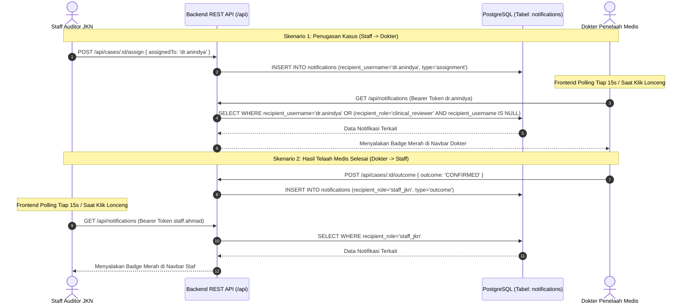

# AUDIT ARSITEKTUR & IMPLEMENTASI NOTIFIKASI MULTI-PERAN MEDCAREJKN

## 1. PENDAHULUAN & RIWAYAT MASALAH

Sistem notifikasi dalam aplikasi **medCareJKN** menjembatani koordinasi audit antara **Staff Auditor JKN** dan **Dokter Penelaah Medis**.

### Temuan Audit Awal (Sebelum Perbaikan):
1. **Mock Sisi Klien Saja (*Client-Side Array*):** Notifikasi awal hanya disimpan sebagai array statis di `localStorage` peramban (`jkn_notifications_v1`). Data hilang saat cache peramban dibersihkan.
2. **Tidak Ada Persistensi Basis Data:** Tidak terdapat tabel `notifications` di PostgreSQL.
3. **Ketiadaan Komunikasi Lintas Peran:** Ketika staf menugaskan kasus, akun dokter tidak menerima pemberitahuan. Begitu pula saat dokter menyelesaikan telaah, staf tidak memperoleh notifikasi.
4. **Klaim "Real-time" yang Keliru:** Penggunaan istilah "real-time push" sebelumnya tidak tepat karena tidak ada infrastruktur WebSocket atau Server-Sent Events (SSE).

---

## 2. ARSITEKTUR IMPLEMENTASI AKTUAL (PERIODIC CLIENT POLLING & DATABASE PERSISTENCE)

> [!NOTE]
> **Keterangan Metode Verifikasi Diagram:** Diagram alur sekuens di bawah diperiksa melalui inspeksi teks dan struktur blok Mermaid. Karena utilitas parser Mermaid CLI (`mmdc`) tidak tersedia di komputer lokal tanpa dependensi tambahan, rendering diagram melalui parser belum diverifikasi secara terprogram.

Notifikasi saat ini beroperasi menggunakan model **penyimpanan basis data relasional terpusat** yang dipadukan dengan **penarikan data berkala (periodic polling)** dari frontend:



---

## 3. STRUKTUR TABEL BASIS DATA POSTGRESQL

Tabel `notifications` diimplementasikan secara resmi melalui berkas migrasi [20261030_001_notifications.sql](file:///D:/medcare/database/migrations/20261030_001_notifications.sql):

```sql
CREATE TABLE IF NOT EXISTS notifications (
    id TEXT PRIMARY KEY,
    case_id VARCHAR(40) REFERENCES cases(case_id) ON DELETE CASCADE,
    recipient_username VARCHAR(50),
    recipient_role VARCHAR(50),
    sender_username VARCHAR(50),
    sender_name TEXT,
    title TEXT NOT NULL,
    message TEXT NOT NULL,
    type VARCHAR(50) NOT NULL,
    read BOOLEAN NOT NULL DEFAULT FALSE,
    created_at TIMESTAMPTZ NOT NULL DEFAULT CURRENT_TIMESTAMP
);

CREATE INDEX IF NOT EXISTS idx_notifications_recipient 
ON notifications(recipient_username, read, created_at DESC);

CREATE INDEX IF NOT EXISTS idx_notifications_role 
ON notifications(recipient_role, read, created_at DESC);
```

### Penjelasan Partisi Penerima:
- **Target Pengguna Spesifik (`recipient_username`):** Digunakan saat kasus ditugaskan secara personal kepada seorang dokter (misal `dr.anindya`). Hanya pengguna tersebut yang menerima notifikasi.
- **Target Grup Peran (`recipient_role`):** Digunakan saat tindakan berdampak luas pada seluruh staf (misal penyelesaian telaah klinis dengan penerima `staff_jkn`). Seluruh pengguna dalam peran tersebut dapat melihat notifikasi.
- **Integritas Relasional:** Kolom `case_id` memiliki *Foreign Key* ke tabel `cases(case_id)` dengan aturan `ON DELETE CASCADE`.

---

## 4. PEMETAAN EVENT TRIGGERS PADA BACKEND

Penerbitan notifikasi dipicu secara tersinkronisasi di dalam transaksi database pada [backend/src/services/caseService.js](file:///D:/medcare/backend/src/services/caseService.js):

| Peristiwa Kasus | Method Pemicu | Penerima Notifikasi | Judul Pesan | Tipe Notifikasi |
|---|---|---|---|---|
| **Disposisi Penugasan** | `assignCaseReviewer` | Dokter penelaah (`recipientUsername: assignedTo`) | *"Penugasan Berkas Kasus [ID]"* | `assignment` |
| **Putusan Telaah Medis** | `submitCaseOutcome` | Seluruh staf JKN (`recipientRole: 'staff_jkn'`) | *"Hasil Telaah Klinis: [ID]"* | `outcome` |
| **Pencatatan Sanggahan** | `recordCaseAction ('dispute')` | Staf JKN & Dokter penelaah kasus | *"Sanggahan Faskes Masuk: [ID]"* | `dispute` |
| **Unggah Bukti Tambahan** | `recordCaseAction ('evidence')` | Rekanan peran kasus (Dokter atau Staf) | *"Bukti Pendukung Ditambahkan: [ID]"* | `evidence` |
| **Permintaan Klarifikasi**| `recordCaseAction ('clarification')`| Dokter penelaah yang dituju | *"Permintaan Klarifikasi Medis: [ID]"* | `clarification` |

---

## 5. MEKANISME KONSUMSI PADA FRONTEND

1. **Polling Berkala (15 Detik):** Pada komponen [MedcareHeader.jsx](file:///D:/medcare/frontend/src/components/layout/MedcareHeader.jsx), `useEffect` menjalankan interval polling setiap 15 detik selama terdapat sesi aktif (`currentUser`).
2. **On-Demand Refresh:** Mengeklik tombol lonceng `#btn-navbar-notifications` memicu pemanggilan HTTP GET `/api/notifications` secara langsung. Tampilan daftar notifikasi dan lencana unread diperbarui setelah respons API berhasil diterima dan diproses oleh state React klien.
3. **Penyimpanan Cache Lokal & Fallback:** Respons API disimpan di `localStorage` sebagai cache sinkronisasi. Jika panggilan jaringan mengalami kegagalan, sistem kembali membaca data cache lokal tanpa menghentikan peramban (*graceful degradation*).
4. **Penandaan Dibaca (*Mark Read*):**
   - Mengklik tombol *"Tandai dibaca"* memanggil `POST /api/notifications/read-all`.
   - Mengklik kartu notifikasi individual memanggil `POST /api/notifications/:id/read` dan mengeksekusi navigasi langsung (*deep linking*) ke berkas kasus terkait via `onSelectCase(n.caseId)`.

---

## 6. ANALISIS RISIKO & BATASAN OPERASIONAL

1. **Pemisahan Pembuatan Record Backend vs Tampilan UI Klien:**
   - **Pembuatan Record di Backend:** Record notifikasi dibuat di backend (tabel `notifications`) saat mutasi terkait (penugasan, putusan outcome, sanggahan, atau penambahan bukti) berhasil diproses dan dikomit di PostgreSQL.
   - **Pemuatan oleh Klien (Polling & Fetch Manual):** Antarmuka pengguna (UI) tidak menggunakan koneksi push persisten (tidak memakai WebSocket maupun Server-Sent Events / SSE). UI memuat notifikasi melalui interval polling berkala setiap 15 detik atau pembaruan manual saat pengguna mengeklik ikon lonceng di navbar.
   - **Pembaruan Tampilan Layar:** Tampilan daftar notifikasi dan lencana unread di peramban diperbarui setelah respons panggilan API HTTP diterima oleh klien, sehingga tidak menyiratkan bahwa daftar notifikasi pasti tampil seketika atau instan di layar pada detik yang sama dengan mutasi di database.
2. **Risiko Duplikasi Notifikasi:** Jika suatu aksi mutasi (misalnya penugasan ulang kasus yang sama) dipicu berulang kali oleh staf, sistem mencatat record notifikasi baru pada setiap pemanggilan API. Tidak ada deduplikasi otomatis di level basis data.
3. **Karakteristik Keamanan:** Notifikasi tersimpan di tabel basis data relasional PostgreSQL standar dengan pencatatan stempel waktu server (`TIMESTAMPTZ`). Sistem tidak menggunakan teknologi ledger kriptografi *blockchain*, melainkan mengandalkan kontrol akses otentikasi sesi JWT dan integritas tabel basis data.

---

## 7. BUKTI PENGUJIAN END-TO-END

Pengujian multi-role runtime dilakukan langsung pada backend aktif menggunakan kasus uji `CASE-0009`:
- Login sebagai `staff.ahmad` (HTTP 200).
- Login sebagai `dr.anindya` (HTTP 200).
- Staf menugaskan kasus `CASE-0009` ke `dr.anindya` via `POST /api/cases/CASE-0009/assign` (HTTP 200). Record notifikasi penugasan tersimpan di database.
- Dokter memeriksa notifikasi: pemanggilan API `/api/notifications` mengembalikan data penugasan baru dengan status `read: false`, dan tampilan klien memperbarui lencana merah setelah respons diterima.
- Dokter menandai notifikasi dibaca via `POST /api/notifications/:id/read` (HTTP 200).
- Dokter menyimpan putusan telaah klinis via `POST /api/cases/CASE-0009/outcome` (HTTP 200). Record notifikasi hasil telaah tersimpan di database.
- Staf memeriksa notifikasi: notifikasi hasil telaah klinis `[NOT_CONFIRMED]` dari dr. Anindya Kusuma berhasil dimuat oleh klien setelah respons API diterima (HTTP 200).
