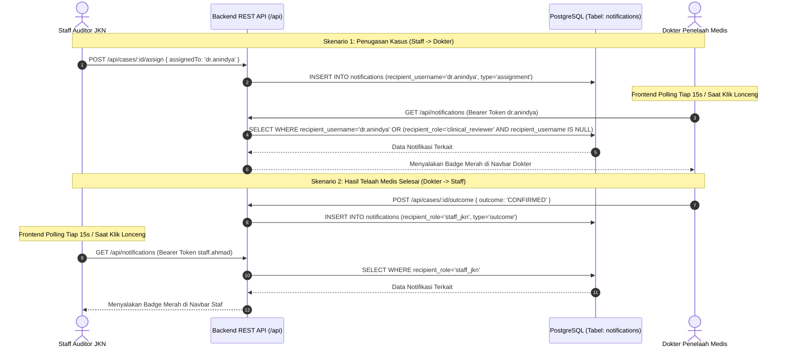

# AUDIT ARSITEKTUR & IMPLEMENTASI NOTIFIKASI MULTI-PERAN MEDCAREJKN

Dokumen ini menjelaskan rancangan arsitektur, skema tabel, mekanisme konsumsi klien, isolasi penerima, serta hasil audit dan verifikasi sistem notifikasi antar-peran pada aplikasi **medCareJKN** berdasarkan kode aktif per **30 Oktober 2026**.

---

## 1. PENDAHULUAN & RIWAYAT PERUBAHAN SISTEM

Sistem notifikasi dalam aplikasi **medCareJKN** menjembatani koordinasi audit antara **Staff Auditor JKN** (`staff_jkn`) dan **Dokter Penelaah Medis** (`clinical_reviewer`).

### Temuan Audit Awal (Sebelum Perbaikan):
1. **Mock Sisi Klien Saja (*Client-Side Array*):** Notifikasi awal hanya disimpan sebagai array statis di `localStorage` peramban (`jkn_notifications_v1`). Data hilang saat cache peramban dibersihkan.
2. **Tidak Ada Persistensi Basis Data:** Tidak terdapat tabel `notifications` di PostgreSQL.
3. **Ketiadaan Komunikasi Lintas Peran:** Ketika staf menugaskan kasus, akun dokter tidak menerima pemberitahuan. Begitu pula saat dokter menyelesaikan telaah, staf tidak memperoleh notifikasi.
4. **Klaim "Real-time" yang Keliru:** Penggunaan istilah "real-time push" sebelumnya tidak tepat karena sistem tidak menggunakan infrastruktur WebSocket atau Server-Sent Events (SSE).

---

## 2. ARSITEKTUR IMPLEMENTASI AKTUAL (PERIODIC CLIENT POLLING & DATABASE PERSISTENCE)

> [!NOTE]
> **Keterangan Metode Verifikasi Diagram:** Diagram alur sekuens di bawah diperiksa melalui inspeksi teks dan struktur blok Mermaid. Karena utilitas parser Mermaid CLI (`mmdc`) tidak tersedia di komputer lokal tanpa dependensi tambahan, rendering diagram melalui parser belum diverifikasi secara terprogram.

Notifikasi saat ini beroperasi menggunakan model **penyimpanan basis data relasional terpusat di PostgreSQL** yang dipadukan dengan **penarikan data berkala (periodic polling) setiap 15 detik** serta **penarikan seketika (on-demand refresh)** saat pengguna mengeklik ikon lonceng pada navbar:



---

## 3. STRUKTUR TABEL BASIS DATA POSTGRESQL

Tabel `notifications` diimplementasikan secara resmi melalui berkas migrasi [20261030_001_notifications.sql](file:///D:/medcare/database/migrations/20261030_001_notifications.sql) pada basis data `jkn_integrity`:

```sql
CREATE TABLE IF NOT EXISTS notifications (
    id TEXT PRIMARY KEY,
    case_id VARCHAR(40) REFERENCES cases(case_id) ON DELETE CASCADE,
    recipient_username VARCHAR(50),
    recipient_role VARCHAR(50),
    sender_username VARCHAR(50),
    sender_name TEXT,
    title TEXT NOT NULL,
    message TEXT NOT NULL,
    type VARCHAR(50) NOT NULL,
    read BOOLEAN NOT NULL DEFAULT FALSE,
    created_at TIMESTAMPTZ NOT NULL DEFAULT CURRENT_TIMESTAMP
);

CREATE INDEX IF NOT EXISTS idx_notifications_recipient 
ON notifications(recipient_username, read, created_at DESC);

CREATE INDEX IF NOT EXISTS idx_notifications_role 
ON notifications(recipient_role, read, created_at DESC);
```

### Penjelasan Relasi & Partisi Penerima:
- **Target Pengguna Spesifik (`recipient_username`):** Digunakan saat kasus ditugaskan secara personal kepada seorang dokter (misal `dr.anindya`). Hanya pengguna tersebut yang dapat melihat dan menerima notifikasi ini.
- **Target Grup Peran (`recipient_role`):** Digunakan saat tindakan berdampak luas pada seluruh staf (misal penyelesaian telaah klinis dengan penerima `staff_jkn`). Seluruh akun pengguna dalam peran tersebut dapat melihat notifikasi.
- **Integritas Relasional:** Kolom `case_id` memiliki *Foreign Key* ke tabel `cases(case_id)` dengan aturan `ON DELETE CASCADE`. Jika berkas kasus dihapus, seluruh notifikasi terkait akan terhapus secara otomatis.

---

## 4. PEMETAAN EVENT TRIGGERS PADA BACKEND

Penerbitan notifikasi dipicu secara tersinkronisasi di dalam transaksi database pada [backend/src/services/caseService.js](file:///D:/medcare/backend/src/services/caseService.js):

| Peristiwa Kasus | Method Pemicu | Penerima Notifikasi | Judul Pesan | Tipe Notifikasi |
|---|---|---|---|---|
| **Disposisi Penugasan** | `assignCaseReviewer` | Dokter penelaah (`recipientUsername: assignedTo`) | *"Penugasan Berkas Kasus [ID]"* | `assignment` |
| **Putusan Telaah Medis** | `submitCaseOutcome` | Seluruh staf JKN (`recipientRole: 'staff_jkn'`) | *"Hasil Telaah Klinis: [ID]"* | `outcome` |
| **Pencatatan Sanggahan** | `recordCaseAction ('dispute')` | Staf JKN & Dokter penelaah kasus | *"Sanggahan Faskes Masuk: [ID]"* | `dispute` |
| **Unggah Bukti Tambahan** | `recordCaseAction ('evidence')` | Rekanan peran kasus (Dokter atau Staf) | *"Bukti Pendukung Ditambahkan: [ID]"* | `evidence` |
| **Permintaan Klarifikasi**| `recordCaseAction ('clarification')`| Dokter penelaah yang dituju | *"Permintaan Klarifikasi Medis: [ID]"* | `clarification` |

---

## 5. MEKANISME KONSUMSI PADA FRONTEND & DEEP LINKING

1. **Polling Berkala (Setiap 15 Detik):**
   - Pada komponen [MedcareHeader.jsx](file:///D:/medcare/frontend/src/components/layout/MedcareHeader.jsx), `useEffect` menjalankan interval polling setiap 15 detik selama terdapat sesi aktif (`currentUser`).
   - Polling memastikan pembaruan berkas dari peran lain termuat tanpa perlu memuat ulang seluruh halaman peramban.
2. **On-Demand Refresh Saat Ikon Lonceng Diklik:**
   - Mengeklik tombol lonceng `#btn-navbar-notifications` memicu pemanggilan HTTP `GET /api/notifications` secara langsung.
   - Tampilan daftar notifikasi dan lencana unread diperbarui seketika setelah respons API berhasil diterima dan diproses oleh state React klien.
3. **Penyimpanan Cache Lokal & Fallback Graceful:**
   - Respons API disimpan di `localStorage` sebagai cache sinkronisasi cepat.
   - Jika panggilan jaringan mengalami gangguan sementara, sistem kembali membaca data cache lokal tanpa menimbulkan galat pada antarmuka.
4. **Navigasi Langsung (Deep Linking) ke Berkas Kasus:**
   - Mengklik kartu notifikasi individual (`.notif-item-card`) memanggil API `POST /api/notifications/:id/read` untuk menandai pesan terbaca, sekaligus mengeksekusi fungsi `onSelectCase(n.caseId)` yang langsung membuka halaman **Detail Kasus** terkait.
5. **Penandaan Massal (Mark All Read):**
   - Mengklik tombol *"Tandai dibaca"* memanggil `POST /api/notifications/read-all`, mereset badge unread menjadi 0 seketika.

---

## 6. ANALISIS RISIKO & BATASAN OPERASIONAL

1. **Pemisahan Pembuatan Record Backend vs Tampilan UI Klien:**
   - Record notifikasi dibuat di backend (tabel `notifications`) saat mutasi terkait (penugasan, putusan outcome, sanggahan, atau penambahan bukti) berhasil diproses dan dikomit di PostgreSQL.
   - Antarmuka pengguna (UI) tidak menggunakan koneksi push persisten (tidak memakai WebSocket maupun SSE). Pembaruan tampilan layar terjadi saat siklus polling 15 detik atau saat pengguna mengeklik ikon lonceng di navbar.
2. **Karakteristik Duplikasi Notifikasi:**
   - Jika staf mengeksekusi penugasan ulang kasus yang sama berulang kali, record notifikasi baru tetap disisipkan untuk setiap pemanggilan API. Tidak ada deduplikasi otomatis di level basis data.
3. **Karakteristik Keamanan:**
   - Notifikasi terlindungi oleh kontrol akses Bearer token JWT dan query SQL berparameter terpartisi role/user.

---

## 7. BUKTI VERIFIKASI RUNTIME PLAYWRIGHT & ISOLASI E2E

Pengujian fungsionalitas notifikasi telah diverifikasi secara runtime:
1. **Automated Playwright Browser Test (`scratch/playwright_audit.py`):**
   - Verifikasi dropdown popover notifikasi pada akun Staff JKN (`staff.ahmad`) dan Dokter Penelaah (`dr.anindya`).
   - Verifikasi on-demand refresh pemanggilan API `/api/notifications` saat ikon lonceng diklik.
   - Verifikasi klik kartu notifikasi berhasil mengeksekusi deep-linking membuka berkas kasus terkait tanpa error console.
2. **Uji Alur E2E Terisolasi Database (`scratch/isolated_e2e_test.mjs`):**
   - Penugasan kasus ke `dr.anindya` berhasil menyisipkan baris notifikasi ke database uji dengan `recipient_username = 'dr.anindya'`.
   - Penyelesaian telaah klinis dengan outcome `CONFIRMED` berhasil menyisipkan notifikasi ke database dengan `recipient_role = 'staff_jkn'`.
   - Pemanggilan notifikasi terbukti mengembalikan data terpartisi secara akurat sesuai hak akses token.
