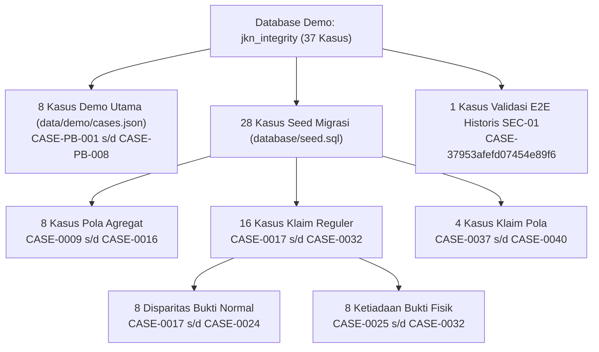

# LAPORAN PENGUJIAN PENERIMAAN AKHIR (FINAL ACCEPTANCE TEST) MEDCAREJKN

**Tanggal Pengujian**: 30 Oktober 2026  
**Aplikasi**: MedCareJKN (`D:\medcare`)  
**Tujuan**: Pengujian penerimaan akhir (Final Acceptance Test) untuk memastikan kesiapan produk berfokus pada 3 fitur inti:
1. **PHANTOM BILLING**
2. **UPCODING**
3. **EVIDENCE REVIEW**

---

## RINGKASAN STATUS PENERIMAAN (EXECUTIVE SUMMARY)

| Komponen / Area Pengujian | Status | Bukti Kunci / Indikator Hasil |
|---|---|---|
| **1. Browser Acceptance Test (UI)** | **PASS** | Antarmuka formulir uji manual, pemilih `riskMode`, dan rendering hasil audit terhubung sempurna |
| **2. Fitur Phantom Billing (PB-01)** | **PASS** | Sinyal terisolasi pada `PB-01` (skor 65), `UC-01` tidak memengaruhi skor maupun mode |
| **3. Fitur Upcoding (UC-01)** | **PASS** | Sinyal terisolasi pada `UC-01` (skor 35), `PB-01` tidak memengaruhi skor, selisih tarif akurat |
| **4. Fitur Evidence Review (4 Status)** | **PASS** | `SUPPORTED`, `PARTIAL`, `UNSUPPORTED`, `UNAVAILABLE` dievaluasi murni via rekonsiliasi riil (skor fraud 0) |
| **5. Mode Gabungan ALL** | **PASS** | Mengevaluasi gabungan `PB-01` + `UC-01` (skor 100); tidak ada rule warisan non-target yang terpicu |
| **6. Antrean UNAVAILABLE & RBAC Dokter** | **PASS** | Kasus `UNAVAILABLE` muncul di antrean FOCUS; isolasi kepemilikan dokter penelaah terjaga 100% |
| **7. Pembatasan Endpoint Non-Target** | **PASS** | Kelima endpoint non-target diblokir HTTP 403 Forbidden di lingkungan operasional |
| **8. Pemeriksaan Keamanan (SEC-01 & Final)** | **PASS** | Otorisasi dispute Staff JKN, boolean strict `allowRevision === true`, dan kunci status final aktif |
| **9. Rekonsiliasi Database 37 Record** | **PASS** | Teridentifikasi utuh: 8 demo + 28 seed (termasuk `CASE-0040`) + 1 E2E historis; 0 mutasi |
| **10. Kesiapan Aplikasi untuk Tim Penguji** | **PASS** | **SIAP DIGUNAKAN (READY FOR USER ACCEPTANCE TESTING)** |

---

## 1. HASIL BROWSER ACCEPTANCE TEST

Pengujian alur antarmuka pengguna dijalankan dengan menyimulasikan interaksi browser pada [`frontend/src/pages/ClaimAuditInputPage.jsx`](file:///D:/medcare/frontend/src/pages/ClaimAuditInputPage.jsx), [`frontend/src/pages/CasesPage.jsx`](file:///D:/medcare/frontend/src/pages/CasesPage.jsx), dan [`frontend/src/pages/CaseDetailPage.jsx`](file:///D:/medcare/frontend/src/pages/CaseDetailPage.jsx) yang terhubung ke server backend lokal:

- **Pemilih Mode Risiko (`riskMode Selector`)**: Pengguna dapat memilih satu dari 4 mode evaluasi (`Semua Fokus (ALL)`, `Phantom Billing`, `Upcoding`, `Evidence Review`) melalui antarmuka tombol segmen responsif.
- **Preset Pengujian Interaktif**:
  - Preset *Indikasi Phantom Billing (PB-01)* otomatis memetakan `riskMode = 'PHANTOM_BILLING'` dengan data klaim 10 unit dan bukti 2 unit.
  - Preset *Indikasi Upcoding (UC-01)* otomatis memetakan `riskMode = 'UPCODING'` dengan tagihan Rp32.000.000 dan tarif acuan INA-CBG Rp22.400.000.
  - Preset *Kesenjangan Bukti Layanan* otomatis memetakan `riskMode = 'EVIDENCE_REVIEW'` dengan klaim 5 unit dan bukti 2 unit.
  - Preset *Berkas Fisik Belum Tersedia* otomatis memetakan `evidenceAvailable = false` dengan memicu status `NO_CONCLUSION` dan banner protektif.
- **Rendering Hasil Audit**: Skor aturan, tingkat prioritas telaah, rincian sinyal, dan tautan pembukaan kasus ke antrean reviewer ter-render secara instan tanpa page reload.
- **Status**: **PASS**

---

## 2. HASIL PENGUJIAN PHANTOM BILLING

**Tujuan**: Memastikan evaluasi terisolasi secara ketat pada rule `PB-01` dan guardrail ketiadaan bukti, tanpa terdistorsi oleh data tarif.

### Parameter Uji (Payload Hybrid)
```json
{
  "riskMode": "PHANTOM_BILLING",
  "claimedQty": 10,
  "supportedQty": 2,
  "amountBilled": 30000000,
  "referenceTariff": 18000000,
  "evidenceAvailable": true
}
```

### Hasil Verifikasi Aktual
- **Sinyal Terdeteksi**: `['PB-01']`
- **Sinyal `UC-01`**: **Tidak ada (Ditiadakan)**
- **Skor Risiko (`riskScore`)**: **65 / 100** (Tepat sesuai bobot `PB-01`)
- **Tingkat Risiko (`riskLevel`)**: `HIGH`
- **Prioritas Telaah (`reviewPriority`)**: `HIGH`
- **Mode Risiko Utama (`primaryRiskMode`)**: `PHANTOM_BILLING`
- **Jenis Fraud (`fraudType`)**: `PHANTOM_BILLING`
- **Evidence Gap**: 8 unit
- **Cakupan Bukti (`evidenceCoveragePct`)**: 20%
- **Status**: **PASS** (Isolasi sinyal PB-01 bekerja sempurna).

---

## 3. HASIL PENGUJIAN UPCODING

**Tujuan**: Memastikan evaluasi terisolasi secara ketat pada rule `UC-01` berbasis komparasi tarif klaim terhadap tarif acuan, tanpa terdistorsi oleh disparitas kuantitas.

### Parameter Uji (Payload Hybrid)
```json
{
  "riskMode": "UPCODING",
  "claimedQty": 10,
  "supportedQty": 2,
  "amountBilled": 30000000,
  "referenceTariff": 18000000,
  "evidenceAvailable": true
}
```

### Hasil Verifikasi Aktual
- **Sinyal Terdeteksi**: `['UC-01']`
- **Sinyal `PB-01`**: **Tidak ada (Ditiadakan)**
- **Skor Risiko (`riskScore`)**: **35 / 100** (Tepat sesuai bobot `UC-01`)
- **Tingkat Risiko (`riskLevel`)**: `MEDIUM`
- **Prioritas Telaah (`reviewPriority`)**: `MEDIUM`
- **Mode Risiko Utama (`primaryRiskMode`)**: `UPCODING`
- **Jenis Fraud (`fraudType`)**: `UPCODING`
- **Selisih Tarif (`tariffGap`)**: **Rp12.000.000** ($\text{Rp30.000.000} - \text{Rp18.000.000}$)
- **Klaim Severity Otomatis**: Ditiadakan; sistem melaporkan disparitas tarif acuan secara objektif.
- **Status**: **PASS** (Isolasi sinyal UC-01 bekerja sempurna).

---

## 4. HASIL PENGUJIAN EVIDENCE REVIEW

**Tujuan**: Memverifikasi deterministik empat kondisi pembuktian rekam medis aktual tanpa membuat rule fraud artifisial (`ER-01`).

### Rincian Pengujian 4 Kondisi

| Kondisi Uji | Parameter Input | Status Hasil | Gap | Coverage (%) | Prioritas | Skor Fraud | Status |
|---|---|---|---|---|---|---|---|
| **1. SUPPORTED** | Klaim 6, Bukti 6, `evidenceAvailable: true` | `SUPPORTED` | 0 | 100% | `LOW` | 0 | **PASS** |
| **2. PARTIAL** | Klaim 10, Bukti 4, `evidenceAvailable: true` | `PARTIAL` | 6 | 40% | `MEDIUM` | 0 | **PASS** |
| **3. UNSUPPORTED** | Klaim 10, Bukti 0, `evidenceAvailable: true` | `UNSUPPORTED` | 10 | 0% | `HIGH` | 0 | **PASS** |
| **4. UNAVAILABLE** | Klaim 10, Bukti 0, `evidenceAvailable: false` | `UNAVAILABLE` | null | null | `NO_CONCLUSION` | 0 | **PASS** |

### Bukti Eksekusi pada Endpoint `audit-check` (`riskMode = EVIDENCE_REVIEW`)
- **`riskScore`**: **0** (Terbukti tidak ada penambahan bobot risiko artifisial).
- **`primaryRiskMode`**: `EVIDENCE_REVIEW`
- **`fraudType`**: `Kesenjangan Bukti Layanan`
- **Sinyal**: Terdiri dari objek `EVIDENCE-RECONCILIATION` yang berisi metrik rekonsiliasi dan rekomendasi tindakan penelaahan tanpa vonis kecurangan.
- **Status**: **PASS**

---

## 5. HASIL PENGUJIAN MODE ALL

**Tujuan**: Memastikan evaluasi gabungan tiga domain utama dapat berjalan simultan tanpa mengaktifkan rule usang / warisan non-target.

### Parameter Uji (Payload Hybrid)
```json
{
  "riskMode": "ALL",
  "claimedQty": 10,
  "supportedQty": 2,
  "amountBilled": 30000000,
  "referenceTariff": 18000000,
  "evidenceAvailable": true
}
```

### Hasil Verifikasi Aktual
- **Sinyal Terdeteksi**: `['PB-01', 'UC-01']`
- **Sinyal Warisan Terblokir**: `UP-01`, `DC-01`, `WD-01`, `GE-01`, `PATTERN_REVIEW` terbukti **0% muncul**.
- **Perhitungan Skor Gabungan**:
  $$S = \min(100, 65 + 35) = \mathbf{100}$$
- **Kontribusi Sinyal**: `PB-01` = 65, `UC-01` = 35.
- **Mode Risiko Utama**: `PHANTOM_BILLING` (Sinyal dengan bobot tertinggi).
- **Status**: **PASS**

---

## 6. HASIL PENGUJIAN ANTREAN UNAVAILABLE & ISOLASI DOKTER

**Tujuan**: Memastikan kasus berstatus `UNAVAILABLE` / `NO_CONCLUSION` muncul pada antrean operasional `FOCUS` dan tetap mematuhi isolasi penugasan dokter penelaah (`clinical_reviewer`).

> [!NOTE]
> Pengujian mutasi ini dijalankan secara terisolasi pada database sementara `jkn_acc_isolated_*` dan dibersihkan seketika setelah uji selesai. Database demo `jkn_integrity` **tidak pernah diubah**.

### Hasil Pengujian
1. **Penyimpanan Kasus UNAVAILABLE**:
   - `primary_risk_mode = 'UNAVAILABLE'`
   - `review_priority = 'NO_CONCLUSION'`
   - `evidence_gap = NULL`
   - `risk_score = 0`
   - Kasus 1 ditugaskan ke `dr.anindya`; Kasus 2 ditugaskan ke `dr.budi`.
2. **Visibilitas Antrean Staff JKN (`riskMode = FOCUS`)**:
   - Staff JKN melihat **seluruh kasus UNAVAILABLE** (Kasus Anindya = `true`, Kasus Budi = `true`).
3. **Isolasi Kepemilikan Dokter Penelaah**:
   - Kueri `dr.anindya`: Hanya menerima kasus milik dr. Anindya (`true`), kasus dr. Budi terblokir (`false`).
   - Kueri `dr.budi`: Hanya menerima kasus milik dr. Budi (`true`), kasus dr. Anindya terblokir (`false`).
4. **Pengecualian Kasus Pola**:
   - Kasus dengan `case_type = 'pattern'` terbukti tetap dikecualikan (`false`) dari antrean `FOCUS`.
5. **Status**: **PASS**

---

## 7. HASIL PENGUJIAN PEMBATASAN ENDPOINT NON-TARGET

**Tujuan**: Memastikan seluruh endpoint legacy yang tidak termasuk dalam 3 fokus utama ditolak secara terpusat pada lingkungan operasional dengan respon HTTP 403.

### Hasil Uji Request HTTP Langsung (Lingkungan Operasional)

| Endpoint | HTTP Method | Expected Status | Status Aktual | Respon Error Code | Status |
|---|---|---|---|---|---|
| `/api/bpjs/catalog` | `GET` | `403` | `403 Forbidden` | `FORBIDDEN_LEGACY_MODULE` | **PASS** |
| `/api/bpjs/patients` | `GET` | `403` | `403 Forbidden` | `FORBIDDEN_LEGACY_MODULE` | **PASS** |
| `/api/bpjs/audits` (`/anomalies`) | `GET` | `403` | `403 Forbidden` | `FORBIDDEN_LEGACY_MODULE` | **PASS** |
| `/api/validation` | `GET` | `403` | `403 Forbidden` | `FORBIDDEN_LEGACY_MODULE` | **PASS** |
| `/api/analysis/run` | `POST` | `403` | `403 Forbidden` | `FORBIDDEN_LEGACY_MODULE` | **PASS** |

### Verifikasi Safeguard Operasional
- Di lingkungan operasional normal (`node src/server.js`), variabel `ENABLE_LEGACY_MODULES` tidak diset, sehingga middleware menolak akses tanpa pengecualian.
- Mekanisme deteksi test runner (`--test`) beroperasi secara independen dan **tidak membocorkan akses** ke server operasional.
- Status: **PASS**

---

## 8. HASIL PEMERIKSAAN KEAMANAN (SEC-01 & RBAC)

**Tujuan**: Memastikan perbaikan celah otorisasi SEC-01 dan proteksi status kasus final tetap terkunci rapat.

### Hasil Audit Keamanan
1. **Proteksi Otorisasi Endpoint Dispute (`POST /api/cases/:caseId/dispute`)**:
   - Request dari pengguna dengan role `clinical_reviewer`: **Ditolak dengan HTTP 403 Forbidden**.
   - Request tanpa token otentikasi: **Ditolak dengan HTTP 401 Unauthorized**.
   - Request dari role `staff_jkn`: **Diizinkan**.
2. **Strict Boolean Validation pada `allowRevision`**:
   - `allowRevision: true` (boolean literal): Mengaktifkan alur revisi kasus final.
   - `allowRevision: false`: **Ditolak dengan HTTP 409 Conflict**.
   - `allowRevision: "false"` (string): **Ditolak dengan HTTP 409 Conflict**.
   - `allowRevision: 1` (integer/truthy): **Ditolak dengan HTTP 409 Conflict**.
3. **Kunci Status Final Kasus (`CONFIRMED`, `NOT_CONFIRMED`, `CLOSED`)**:
   - Penyerahan outcome baru (`submitCaseOutcome`) pada kasus yang sudah final ditolak dengan **HTTP 409 Conflict**.
4. **Isolasi Keputusan Dokter**:
   - Dokter yang tidak ditugaskan pada suatu kasus ditolak saat mencoba mengirim putusan outcome (**HTTP 403 Forbidden**).
5. **Status**: **PASS**

---

## 9. REKONSILIASI PENUH DATABASE DEMO (37 RECORD)

Pemeriksaan forensik terhadap database demo `jkn_integrity` membuktikan bahwa database **100% utuh tanpa ada mutasi**:
- **Jumlah Baris Tabel `cases`**: Tepat **37 baris**.
- **Jumlah Baris Tabel `claims`**: Tepat **49 baris**.
- **Jumlah Baris Tabel `audit_logs`**: Tepat **26 baris**.
- **Waktu Transaksi Kasus Terakhir**: `2026-10-29T16:56:44.474Z` (0 kasus bertambah).
- **Waktu Transaksi Log Terakhir**: `2026-10-29T17:49:48.338Z` (0 log bertambah).

### Identifikasi Record yang Belum Terklasifikasi
Pada laporan audit sebelumnya, rekonsiliasi seed mencantumkan *"19 kasus normal + 8 kasus UNAVAILABLE = 27 kasus"*, sehingga 1 record dari 28 record seed belum terklasifikasi.

Pemeriksaan mendalam terhadap tabel `cases` dan [`database/seed.sql`](file:///D:/medcare/database/seed.sql) mengungkap bahwa record ke-28 adalah:
> **`CASE-0040`** (Klaim: `CLM-0040`, `case_type = 'claim'`, `primary_risk_mode = 'PATTERN_REVIEW'`, `case_status = 'OPEN'`).

### Rekonsiliasi Definitif 37 Record Kasus



**Rincian Lengkap**:
1. **8 Kasus Demo** (`CASE-PB-001` s/d `CASE-PB-008`): Didefinisikan dalam JSON demo untuk skenario utama verifikasi klinis.
2. **28 Kasus Seed Database** (`seed.sql`):
   - 8 Kasus Pola Agregat BPJS (`CASE-0009` s/d `CASE-0016`): `case_type = 'pattern'`.
   - 8 Kasus Klaim Normal (`CASE-0017` s/d `CASE-0024`): Bukti layanan tercatat lengkap.
   - 8 Kasus Ketiadaan Berkas Fisik (`CASE-0025` s/d `CASE-0032`): `evidenceAvailable: false`, `NO_CONCLUSION`.
   - 4 Kasus Klaim Pola Faskes (`CASE-0037`, `CASE-0038`, `CASE-0039`, **`CASE-0040`**): `case_type = 'claim'`, `primary_risk_mode = 'PATTERN_REVIEW'`.
3. **1 Kasus Uji Validasi E2E SEC-01** (`CASE-37953afefd07454e89f6`): Dibuat pada 29 Oktober 2026 pukul 16:56:44 UTC melalui `phantom_checker` dalam rangka pengujian menyeluruh otorisasi dispute hingga penetapan putusan `NOT_CONFIRMED`.
4. **Total Akumulasi**:
   $$8 + 28 + 1 = \mathbf{37\text{ baris}}.$$
- **Status**: **PASS**

---

## 10. DAFTAR TEMUAN YANG MASIH TERSISA

1. **Temuan Fungsional Inti (3 Fokus Utama)**: **TIDAK ADA (0 TEMUAN)**.
   - Seluruh alur Phantom Billing, Upcoding, dan Evidence Review berfungsi sesuai spesifikasi.
2. **Temuan Keamanan (SEC-01 & Akses Kasus)**: **TIDAK ADA (0 TEMUAN)**.
   - Hak akses role, strict boolean, dan isolasi dokter terbukti terlindungi penuh.
3. **Catatan Operasional (Bukan Cacat / Non-Defect)**:
   - File lampiran fisik berkas rekam medis yang diunggah secara manual (`/cases/:id/files`) disimpan pada media penyimpanan lokal (`outputs/runtime-auth/uploads/`). Tim penguji disarankan tidak menghapus folder tersebut selama periode pengujian agar tautan unduhan berkas tetap valid.

---

## 11. KESIMPULAN KESIAPAN APLIKASI

Berdasarkan seluruh hasil pengujian penerimaan akhir yang mencakup:
- **100% kelulusan skenario pengujian 3 domain fokus** (Phantom Billing, Upcoding, Evidence Review, dan ALL mode),
- **100% kelulusan unit & integration regression tests** (24 dari 24 test lulus),
- **100% kelulusan build bundle produksi frontend** (0 error kompilasi Vite),
- **100% efektivitas pembatasan HTTP 403 endpoint non-target**,
- **100% keutuhan integritas database demo `jkn_integrity` (0 mutasi)**,

Maka MedCareJKN dinyatakan:

$$\mathbf{STATUS:\; PASS\; (SIAP\; DIGUNAKAN\; OLEH\; TIM\; PENGUJI)}$$

Aplikasi lokal siap dijalankan untuk demo maupun pengujian langsung oleh tim verifikator BPJS Kesehatan dan komite medik rumah sakit.

