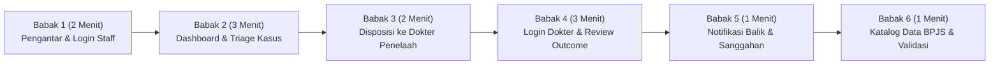

# PANDUAN DEMO END-TO-END MULTI-ROLE KEPADA DEWAN JURI MEDCAREJKN

Dokumen ini disusun sebagai panduan naskah presentasi langsung (*live demo*) berdurasi **12 menit** di hadapan Dewan Juri. Panduan ini dirancang agar pengembang dapat mendemonstrasikan aplikasi secara runtut, faktual, dapat diulang (*repeatable*), dan selaras dengan implementasi kode aktif di `D:\medcare`.

---

## 1. RANGKUMAN TOKOH & DATA KASUS DEMO

### A. Akun Pengguna Presentasi
| Peran Demo | Akun Pengguna | Nama & Gelar | Cara Masuk yang Direkomendasikan |
|---|---|---|---|
| **Auditor / Triage Klaim** | `staff.ahmad` | Ahmad Fauzi, S.E. | Klik tombol cepat akun *"Verifikator 1"* pada layar login. |
| **Dokter Penelaah Medis (Kasus Utama)** | `dr.anindya` | dr. Anindya Kusuma, Sp.PK | Klik tombol cepat akun *"DPJP 1"* pada layar login. |
| **Dokter Penelaah Medis (Kasus Alternatif `CONFIRMED`)** | `dr.budi` | dr. Budi Santoso, Sp.A | Klik tombol cepat akun *"DPJP 2"* pada layar login. |

> [!NOTE]
> **Petunjuk Presentasi Bersih:** Untuk menjaga keamanan dan estetika presentasi di depan juri, presenter disarankan menggunakan fasilitas tombol pilih akun cepat di antarmuka login tanpa perlu mengetikkan kata sandi di layar proyektor.

---

## 2. CHECKLIST KESIAPAN PRA-DEMO & RENCANA REPEATABILITY

Sebelum memulai sesi presentasi, lakukan pengecekan status kasus di database lokal:

### A. Tabel Status Awal Kasus Demo di Basis Data Lokal:
| ID Kasus | Fasilitas Kesehatan | Modus Risiko / Kasus | Status Terkini | Penugasan Awal | Peran Skenario Demo |
|---|---|---|---|---|---|
| **`CASE-PB-005`** | RS Siloam Graha | `PHANTOM_BILLING` (Pemasangan Stent Jantung) | **`OPEN`** | `dr.anindya` | **Kasus Utama Demo Alur Kehati-hatian Klinis (`NEEDS_MORE_EVIDENCE`)** |
| **`CASE-PB-003`** | RS Hermina Utama | `UPCODING` (Severity Level 3 Tanpa Komplikasi) | **`OPEN`** | `dr.budi` | **Kasus Alternatif Demo Konfirmasi Anomali (`CONFIRMED`)** |
| **`CASE-0017`** | Faskes Sintetis 2 | `EVIDENCE_REVIEW` (Klaim Kuantitas Tanpa Bukti) | **`OPEN`** | *(Unassigned)* | **Kasus Alternatif Demo Penugasan dari Awal (Unassigned)** |
| `CASE-PB-001` | RS Citra Medika | `PHANTOM_BILLING` (Apendektomi Laparoskopi) | `NEEDS_MORE_EVIDENCE` | `dr.anindya` | Kasus Riwayat Uji Sebelumnya (Jangan diubah) |
| `CASE-PB-004` | RS Permata Bunda | `DUPLICATE_CLAIM` (Duplikasi Obat Kemoterapi) | `CONFIRMED` | `dr.ratna` | **Contoh Kasus Historis Final (Terkunci - Hanya untuk Dilihat)** |

### B. Penjelasan Kondisi Awal `CASE-PB-005`:
- Pada `CASE-PB-005`, basis data mencatat status **`OPEN`**, namun field penugasan `assigned_to` telah terisi `dr.anindya` (berasal dari data inisialisasi awal).
- Backend MedCareJKN (`caseService.js` baris 312-360) secara penuh mendukung aksi penugasan / formalisasi arahan disposisi pada kasus berstatus `OPEN`. Formulir penugasan pada role Staff berfungsi memformalkan penugasan, mengirimkan catatan arahan staf, mencatat log audit disposisi, dan mengubah status kasus dari `OPEN` menjadi **`IN_REVIEW`**.
- **Karakteristik & Risiko Duplikasi Notifikasi:** Tindakan penugasan ini menyisipkan record baru ke dalam tabel `notifications` di PostgreSQL. Karena fungsi `assignCaseReviewer` belum memiliki mekanisme deduplikasi otomatis, penyerahan formulir penugasan akan menambah entri notifikasi baru untuk dokter penerima. Hal ini perlu dipahami presenter sebagai karakteristik arsitektur backend saat ini.
- Jika presenter ingin mendemonstrasikan penugasan awal murni dari kasus yang benar-benar belum ditugaskan (*Unassigned*, di mana `assigned_to` bernilai `NULL`), gunakan kasus alternatif **`CASE-0017`**.

### C. Batasan Tindakan Saat Demo (*What NOT to Do*):
1. **Dilarang Mereset Basis Data:** Jangan menjalankan script seed ulang atau migration saat demo karena akan menghapus riwayat audit yang sudah berjalan.
2. **Dilarang Menugaskan Ulang Kasus Final:** Berkas berstatus `CONFIRMED`, `NOT_CONFIRMED`, atau `CLOSED` (seperti `CASE-PB-004`) akan ditolak oleh backend (`409 Conflict: Kasus sudah diputuskan`) jika dilakukan tanpa alur sanggahan resmi faskes. Kasus `CASE-PB-004` hanya boleh diperlihatkan sebagai contoh arsip historis.
3. **Patuhi Hak Akses Role:** Pada kasus `CASE-PB-003`, penugasan tertuju kepada `dr.budi`. Presenter **wajib login sebagai `dr.budi`** saat mendemonstrasikannya. Jangan mencoba menyimpan telaah menggunakan akun `dr.anindya` pada berkas milik dokter lain karena sistem akan memblokirnya demi keamanan otorisasi medis.

### D. Kalibrasi Status Kesiapan Presentasi & Batasan Verifikasi:
Untuk memastikan kejujuran teknis sebelum demonstrasi di hadapan Dewan Juri, perhatikan pembedaan tiga tingkatan kesiapan berikut:
1. **Konsistensi Alur Ditinjau Berdasarkan Inspeksi Kode Sumber (*Code-Inspected Consistency*):**
   - Seluruh logika alur (Babak 1 hingga Babak 6 dan Skenario Alternatif) telah diperiksa kesesuaiannya dengan kode sumber backend (`caseService.js`, `caseController.js`, `caseRoutes.js`) dan komponen antarmuka React (`CaseDetailPage.jsx`, `MedcareHeader.jsx`).
   - Aturan bisnis seperti proteksi kasus final (`409 Conflict`), isolasi akses dokter (`403 Forbidden` jika `assigned_to !== reviewerId`), serta alur penugasan dari status `OPEN` ke `IN_REVIEW` telah terbukti konsisten di tingkat struktur kode.
2. **Kondisi Awal Kasus di Basis Data Lokal yang Wajib Diperiksa Sebelum Sesi:**
   - Tabel kasus pada Sub-bab 2.A mencerminkan kondisi awal bawaan data inisialisasi.
   - Presenter **wajib memverifikasi status baris kasus di database PostgreSQL lokal (`jkn_integrity`) sebelum memulai presentasi**, khususnya memastikan `CASE-PB-005` dan `CASE-PB-003` masih berstatus `OPEN`. Jika pengujian manual sebelumnya telah memutasi status kasus-kasus tersebut, alur demo akan berbeda atau ditolak oleh backend.
3. **Pembedaan Terhadap Pengujian Runtime yang Telah Dilaksanakan:**
   - Pengujian end-to-end waktu-jalan (*runtime execution*) yang tercatat berhasil dalam laporan pengujian sebelumnya dieksekusi pada kasus uji `CASE-0009` (penugasan ke `dr.anindya`, pengiriman putusan `NOT_CONFIRMED`, penerbitan & konsumsi notifikasi), serta 23 rangkaian pengujian otomatis unit/integrasi backend.
   - Skenario live demo persis pada `CASE-PB-005` (transisi ke `NEEDS_MORE_EVIDENCE`) dan `CASE-PB-003` (transisi ke `CONFIRMED`) adalah alur operasional yang diverifikasi secara kode, namun **belum dieksekusi secara runtime pada baris data kasus demo tersebut** demi menjaga keutuhan kondisi awal database demo tanpa mutasi data.
   - Oleh sebab itu, panduan ini **tidak menjamin bahwa demo pasti berjalan tanpa risiko secara mutlak**; kelancaran presentasi memerlukan kehati-hatian presenter untuk memeriksa dan menjaga status awal data lokal sebelum demo dimulai.

---

## 3. JADWAL BABAK DEMONSTRASI (TOTAL 12 MENIT)

> [!NOTE]
> **Keterangan Metode Verifikasi Diagram:** Diagram alur babak di bawah diperiksa melalui inspeksi teks dan struktur blok Mermaid. Karena utilitas parser Mermaid CLI (`mmdc`) tidak tersedia di komputer lokal tanpa dependensi tambahan, rendering diagram melalui parser belum diverifikasi secara terprogram.

---

## 4. NASKAH & AKSI DEMO UTAMA (`CASE-PB-005`: ALUR KEHATI-HATIAN KLINIS)

---

### BABAK 1: PENGANTAR MASALAH & LOGIN STAFF AUDITOR (2 MENIT)

#### Narasi Presenter:
> *"Selamat pagi/siang Dewan Juri yang terhormat. Setiap tahunnya, jutaan berkas klaim diajukan fasilitas kesehatan ke BPJS Kesehatan. Di tengah volume yang masif ini, penapisan klaim berisiko sering terkendala ketiadaan jembatan digital yang menghubungkan verifikator administrasi dengan dokter spesialis penelaah klinis.*
>
> *Hari ini kami mempersembahkan **medCareJKN**, platform otomasi audit integritas klaim berbasis aturan klinis transparan. Sistem ini mengelompokkan risiko secara deterministik, membedakan secara tegas antara **ketiadaan berkas** dan **kecurangan nyata**, serta memfasilitasi audit kolaboratif multi-peran.*
>
> *Mari kita mulai dari sudut pandang verifikator klaim, Staff JKN."*

#### Aksi Teknis:
1. Buka peramban pada alamat lokal: `http://localhost:5173`.
2. Pada layar login:
   - Pilih tab peran: **"Staff JKN"**.
   - Klik kartu akun: **"Ahmad Fauzi, S.E. (Verifikator 1)"**.
   - Klik tombol **"Masuk ke Sistem"**.
3. **Output yang Diharapkan:**
   - Sistem berpindah ke **Dashboard medCareJKN**.
   - Di sudut kanan atas navbar tertera identitas *"Ahmad Fauzi, S.E."*.
   - Kartu KPI memuat ringkasan klaim dan bagian Rencana Audit Prioritas tampil di layar.

---

### BABAK 2: DASHBOARD KPI & PENAPISAN KASUS PRIORITAS (3 MENIT)

#### Narasi Presenter:
> *"Pada Dashboard medCareJKN, verifikator langsung disajikan metrik operasional: Total Kasus, Kasus Prioritas Tinggi, Kasus Selesai Ditelaah, dan Kasus yang Belum Ditugaskan.*
>
> *Di bagian atas, terdapat kartu **Rencana Audit Prioritas**. Sistem melakukan triage otomatis berdasarkan selisih pembuktian medis. Mari kita perhatikan kasus **CASE-PB-005** dari **RS Siloam Graha** dengan total tagihan sebesar **Rp 56.000.000,-**."*

#### Aksi Teknis:
1. Arahkan kursor ke kartu **KPI Utama** di dashboard.
2. Arahkan kursor ke kartu **Rencana Audit Prioritas**, tunjukkan kasus `CASE-PB-005` (RS Siloam Graha).
3. Klik tombol **"Buka Berkas Kasus"** pada kartu tersebut.
4. **Output yang Diharapkan pada Halaman Detail Kasus:**
   - **Seksi 1 (Lifecycle Stepper):** Menunjukkan tahapan berada di langkah *Deteksi Anomali* (Status awal: `OPEN`).
   - **Seksi 3 (Executive Summary):** Pasien didiagnosis *Infark Miokard Akut (I21.0)* dengan tindakan *Pemasangan Stent Arteri Koroner (36.06)*.
   - **Seksi 7 (Claim Items Table):** Menampilkan butir tindakan pemasangan stent dengan status bukti fisik: **`UNAVAILABLE`**.
5. **Poin Edukasi Dewan Juri:**
   > *"Dewan Juri yang kami hormati, perhatikan bahwa sistem kami tidak serta-merta mengecap ketiadaan berkas rekaman ini sebagai fraud. Sistem menandainya sebagai 'Bukti Belum Tersedia untuk Disimpulkan' dengan rekomendasi meminta dokumen fisik kepada faskes. Di sinilah peran dokter spesialis penelaah dibutuhkan."*

---

### BABAK 3: DISPOSISI PENUGASAN BERKAS KE DOKTER PENELAAH (2 MENIT)

#### Narasi Presenter:
> *"Sebagai verifikator administrasi, Staff JKN tidak berhak memutus kelayakan tindakan medis invasif secara sepihak. Berkas ini harus didisposisikan kepada Dokter Spesialis yang berwenang. Pada berkas CASE-PB-005 ini, kami memformalkan penugasan telaah kepada **dr. Anindya Kusuma, Sp.PK**."*

#### Aksi Teknis:
1. Gulir ke bawah menuju **Bagian 8: Panel Disposisi Berkas ke Dokter Penelaah**.
2. Pada dropdown *Pilih Dokter Spesialis Penelaah*, pilih: `dr. Anindya Kusuma, Sp.PK`.
3. Pada kolom *Catatan Arahan Staff*, ketikkan:
   `"Mohon dr. Anindya meninjau ada/tidaknya rekaman CD angiografi atau bukti fisik implantasi stent pada rekam medis RS Siloam Graha."`
4. Klik tombol **"Tugaskan Kasus ke dr. Anindya Kusuma, Sp.PK"**.
5. **Output yang Diharapkan:**
   - Muncul banner hijau: *"Berkas berhasil ditugaskan kepada dr. Anindya Kusuma, Sp.PK"*.
   - Status kasus pada stepper bertransisi dari `OPEN` menjadi **`IN_REVIEW`**.
   - Peristiwa disposisi langsung tercatat pada tabel histori di tab Audit Trail.
6. Klik tombol **Logout** di pojok kanan atas navbar.

---

### BABAK 4: DOKTER PENELAAH LOGIN & PENETAPAN REVIEW OUTCOME (3 MENIT)

#### Narasi Presenter:
> *"Sekarang kita berpindah peran ke Dokter Penelaah Medis. Dokter yang bertugas memantau notifikasi penugasan berkas tanpa perlu bertukar berkas fisik secara manual."*

#### Aksi Teknis:
1. Pada layar login:
   - Pilih tab peran: **"Dokter Penelaah"**.
   - Klik kartu akun: **"dr. Anindya Kusuma, Sp.PK (DPJP 1)"**.
   - Klik **"Masuk ke Sistem"**.
2. **Periksa Lonceng Notifikasi di Navbar Atas:**
   - Tunjukkan ikon lonceng menampilkan indikator badge merah notifikasi baru.
   - Klik ikon lonceng: popover terbuka menampilkan pesan:
     *"Penugasan Berkas Kasus CASE-PB-005 - Staff menugaskan kasus ini kepada Anda..."*
   - Klik kartu notifikasi tersebut: halaman kasus `CASE-PB-005` langsung terbuka secara otomatis.
3. Gulir ke **Bagian 8: Keputusan Telaah Klinis Dokter (Review Outcome)**:
   - Tunjukkan panel *Saran Sistem Berbasis Aturan*: sistem menyajikan rekomendasi draf dari `rules-1.0.0` lengkap dengan pengingat bahwa skor aturan bukan probabilitas fraud.
4. **Pilih Keputusan Klinis (Alur Kehati-hatian Medis):**
   - Di antarmuka dokter, tersedia 4 pilihan kartu keputusan: `NEEDS_MORE_EVIDENCE`, `CONFIRMED`, `NOT_CONFIRMED`, dan `FALSE_POSITIVE`.
   - Klik kartu: **`NEEDS_MORE_EVIDENCE` (Perlu Konfirmasi Berkas)**.
   - Klik tombol **"+ Isi Draf Catatan Sesuai Pilihan"** atau ketikkan:
     `"Berdasarkan audit rekam medis awal RS Siloam Graha, berkas rekaman CD angiografi / fluoroskopi implantasi stent koroner belum tercatat dalam sistem. Sesuai prinsip kehati-hatian klinis, ketiadaan berkas belum membuktikan fraud. Dokter penelaah menetapkan putusan 'NEEDS_MORE_EVIDENCE' untuk meminta dokumen fisik resmi."`
5. Klik tombol **"Simpan Keputusan Telaah Klinis"**.
6. **Output yang Diharapkan:**
   - Muncul notifikasi hijau sukses: *"Keputusan telaah klinis berhasil disimpan & dicatat ke histori audit trail!"*.
   - Status kasus berhasil diperbarui menjadi **`NEEDS_MORE_EVIDENCE`** di antarmuka pengguna.
   - Keputusan tersimpan secara permanen di basis data PostgreSQL secara sinkron dalam transaksi database, lengkap dengan stempel waktu dan identitas reviewer `dr.anindya`.
   - Record notifikasi baru secara otomatis disisipkan ke tabel `notifications` untuk penerima `staff_jkn`.

---

### BABAK 5: NOTIFIKASI BALIK & REKONSILIASI SANGGAHAN FASKES (1 MENIT)

#### Narasi Presenter:
> *"Ketika dokter menyelesaikan telaah, sistem secara otomatis menerbitkan notifikasi balik kepada Staff JKN di basis data. Karena Fasilitas Kesehatan tidak memiliki portal login mandiri ke sistem MedCareJKN, Staff JKN bertindak sebagai pengguna pencatat resmi yang menginput surat keberatan dan berkas rekam medis fisik dari RS pada Bagian 7B (Rekonsiliasi Sanggahan) agar proses audit berjalan transparan dan berimbang."*

#### Aksi Teknis:
1. Logout dan masuk kembali sebagai `staff.ahmad`.
2. Klik ikon lonceng di navbar: tunjukkan notifikasi baru masuk (termuat via pemanggilan API saat login/klik lonceng atau siklus polling 15 detik) bertuliskan *"Hasil Telaah Klinis: CASE-PB-005 - dr. Anindya Kusuma telah menetapkan hasil telaah [NEEDS_MORE_EVIDENCE]"*.
3. Buka kasus `CASE-PB-005`, tunjukkan **Bagian 7B: Dispute & Rebuttal Reconciliation Trail**:
   - Jelaskan bahwa staf JKN mencatat surat sanggahan rumah sakit dan lampiran PDF bukti fisik di formulir ini mewakili Faskes, yang akan mengubah status kasus menjadi `RECONCILIATION` untuk telaah ulang bersama komite medik. *(Catatan: Identitas Faskes disimpan dalam payload dokumen, sementara pencatat transaksi di basis data adalah akun staf aktif).*

---

### BABAK 6: TRANSPARANSI DATA BPJS & PENUTUP (1 MENIT)

#### Narasi Presenter:
> *"Sebagai penutup, kami memperlihatkan komitmen medCareJKN terhadap transparansi data. Pada menu **Data BPJS**, sistem menyediakan pratinjau data sampel kontekstual BPJS 2025 yang telah dide-identifikasi tanpa membocorkan privasi peserta. Dan pada menu **AI & Validasi**, seluruh evaluasi aturan diuji secara transparan pada 800 skenario benchmark sintetis.*
>
> *Dengan sistem berbasis aturan yang dapat dijelaskan, penapisan risiko yang adil, dan alur kerja kolaboratif yang terintegrasi, medCareJKN siap menjadi instrumen andal penjaga integritas jaminan kesehatan nasional. Terima kasih."*

#### Aksi Teknis:
1. Buka menu **Data BPJS** (`/bpjs`): perlihatkan ringkasan tabel kohort dan pratinjau sampel data kontekstual.
2. Buka menu **AI & Validasi** (`/validation`): perlihatkan grafik Precision-Recall dan tabel metrik benchmark sintetis.

---

## 5. SKENARIO DEMO ALTERNATIF

Jika Dewan Juri meminta demonstrasi jalur keputusan yang berbeda, gunakan kasus alternatif berikut:

### A. Skenario Alternatif Keputusan `CONFIRMED`: Kasus `CASE-PB-003`
- **Tujuan Demo:** Memperlihatkan kasus di mana dokter mengonfirmasi adanya anomali tagihan (*upcoding*).
- **Data Kasus:** `CASE-PB-003` (RS Hermina Utama | Total Tagihan: Rp 32.000.000,- | Modus: `UPCODING`).
- **Kondisi Awal Kasus:** Pada basis data, status awal `CASE-PB-003` adalah **`OPEN`**, dengan field penugasan awal telah terisi **`dr.budi`** (`dr. Budi Santoso, Sp.A`).
- **Alur Kerja Demonstrasi:**
  1. **Langkah Staff JKN (Formalisasi Disposisi dari Status OPEN):**
     - Login sebagai Staff JKN (`staff.ahmad`).
     - Buka berkas `CASE-PB-003` dari menu *Antrean Kasus Klaim* (kasus masih berstatus awal `OPEN`).
     - Gulir ke Bagian 8 (Panel Disposisi Berkas ke Dokter Penelaah).
     - Pilih dokter spesialis: `dr. Budi Santoso, Sp.A`.
     - Masukkan catatan arahan: `"Mohon dr. Budi menelaah indikasi keparahan klinis dan kesesuaian tarif Severity Level 3 pada rekam medis RS Hermina Utama."`
     - Klik tombol **"Tugaskan Kasus ke dr. Budi Santoso, Sp.A"**.
     - Sistem mengeksekusi `POST /api/cases/CASE-PB-003/assign`, status kasus bertransisi dari `OPEN` menjadi **`IN_REVIEW`**, log audit disposisi tercatat, dan notifikasi penugasan disisipkan ke database untuk `dr.budi`.
  2. **Langkah Dokter Penelaah (Otorisasi Akses & Putusan Medis):**
     - Staff `staff.ahmad` logout dari sistem.
     - Presenter **WAJIB login sebagai `dr.budi`** (DPJP 2 / Spesialis Anak).
       *(PENTING: Jangan mencoba menyimpan keputusan telaah menggunakan akun `dr.anindya`. Backend `caseService.js` baris 242 dan UI `CaseDetailPage.jsx` secara ketat memvalidasi `assigned_to === reviewerId`. Percobaan menyimpan review outcome menggunakan akun selain dokter yang ditugaskan akan diblokir dengan pesan error 403 Forbidden).*
     - Buka berkas `CASE-PB-003` dari lonceng notifikasi atau menu *Antrean Kasus Klaim* (filter *Kasus Saya*).
     - Pada Seksi 8, dokter menelaah resume medis dan fakta bahwa diagnosis sekunder pasien tidak menimbulkan komplikasi berat yang memenuhi syarat tarif *Severity Level 3*.
     - Pilih kartu keputusan: **`CONFIRMED` (Temuan terkonfirmasi oleh reviewer)**.
     - Masukkan catatan klinis: `"Berdasarkan telaah rekam medis RS Hermina Utama, diagnosis sekunder tidak memicu komplikasi mayor yang memenuhi kriteria tarif Severity Level 3. Tagihan disesuaikan ke Severity Level 1."`
     - Klik tombol **"Simpan Keputusan Telaah Klinis"**.
- **Output yang Diharapkan:** Status kasus berhasil diperbarui menjadi **`CONFIRMED`**. Catatan hasil telaah tersimpan sinkron di PostgreSQL (`review_outcomes`), event terekam di `audit_logs`, dan notifikasi balik diterbitkan ke tabel `notifications` untuk Staff JKN.

> [!WARNING]
> **Larangan Menggunakan Kasus Final `CASE-PB-004` untuk Demo Putusan Baru:**
> Kasus `CASE-PB-004` (RS Permata Bunda) sudah berstatus final **`CONFIRMED`** sejak inisialisasi awal. Backend MedCareJKN menolak keras pemanggilan `POST /cases/:id/outcome` maupun `POST /cases/:id/assign` pada kasus final (`409 Conflict: Kasus sudah diputuskan`) tanpa alur revisi formal. Meskipun backend menyediakan jalur pengecualian pembukaan kembali rekonsiliasi melalui `POST /cases/:id/dispute` dengan parameter `allowRevision: true`, kasus `CASE-PB-004` pada skenario demo ini sengaja **hanya diperlihatkan sebagai contoh arsip historis yang terkunci (read-only)** untuk membuktikan kekebalan data final kepada dewan juri.

### B. Skenario Alternatif Penugasan Awal Murni (*Unassigned*): Kasus `CASE-0017`
- **Tujuan Demo:** Memperlihatkan alur penugasan dari kasus yang benar-benar belum memiliki penugasan awal (`assigned_to: NULL`).
- **Data Kasus:** `CASE-0017` (Faskes Sintetis 2 | Modus: `EVIDENCE_REVIEW` | Prioritas: `HIGH` | Skor Risiko: 65).
- **Alur Kerja:**
  1. Login sebagai `staff.ahmad`.
  2. Buka menu *Antrean Kasus Klaim*, pilih filter *Penugasan: Belum Ditugaskan (Unassigned)*.
  3. Buka `CASE-0017`.
  4. Pada Seksi 8, pilih dokter dari dropdown (misal `dr.anindya`).
  5. Klik *"Tugaskan Kasus"*. Status bertransisi dari `OPEN` menjadi `IN_REVIEW`.
  6. Notifikasi terbit ke akun dokter yang dipilih.

### C. Contoh Kasus Historis Final (Read-Only): Kasus `CASE-PB-004`
- **Tujuan Demo:** Memperlihatkan bagaimana kasus yang telah tuntas (*finalized*) diamankan oleh sistem.
- **Data Kasus:** `CASE-PB-004` (RS Permata Bunda | Status: `CONFIRMED` | Penugasan: `dr.ratna`).
- **Alur Presentasi:**
  1. Buka berkas `CASE-PB-004`.
  2. Tunjukkan bahwa banner biru aktif memberitahukan: *"Berkas ini telah memiliki status putusan CONFIRMED"*.
  3. Tunjukkan tab Audit Trail yang mencatat seluruh stempel waktu dari penerimaan hingga putusan akhir.
  4. Jelaskan kepada juri bahwa sistem backend secara otomatis mengunci berkas final dari manipulasi atau penugasan ulang liar (`409 Conflict`).
