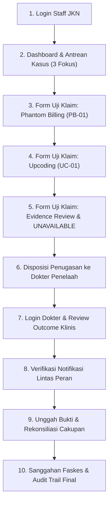

# PANDUAN DEMO END-TO-END MULTI-ROLE KEPADA DEWAN JURI MEDCAREJKN

Dokumen ini disusun sebagai naskah demonstrasi langsung (*live demo*) berdurasi **12 menit** di hadapan Dewan Juri dan Tim Evaluator. Seluruh skrip difokuskan secara eksklusif pada **Tiga Domain Utama: Phantom Billing, Upcoding, dan Evidence Review** berdasarkan implementasi kode operasional di `D:\medcare` per **30 Oktober 2026**.

---

## 1. RANGKUMAN TOKOH & DATA KASUS DEMO

### A. Akun Pengguna Presentasi
| Peran Demo | Akun Pengguna | Nama Lengkap & Gelar | Akses Masuk Cepat |
|---|---|---|---|
| **Auditor / Triage Klaim** | `staff.ahmad` | Ahmad Fauzi, S.E. | Klik tombol cepat *"Verifikator 1"* pada layar login. |
| **Dokter Penelaah Medis (Kasus Utama)** | `dr.anindya` | dr. Anindya Kusuma, Sp.PK | Klik tombol cepat *"DPJP 1"* pada layar login. |
| **Dokter Penelaah Medis (Alternatif)** | `dr.budi` | dr. Budi Santoso, Sp.A | Klik tombol cepat *"DPJP 2"* pada layar login. |

> [!NOTE]
> **Petunjuk Presentasi Bersih:** Untuk menjaga kelancaran dan estetika di hadapan juri, presenter disarankan menggunakan tombol pilih akun instan di antarmuka login tanpa perlu mengetikkan kata sandi di layar proyektor.

---

## 2. CHECKLIST KESIAPAN PRA-DEMO & INTEGRITAS DATABASE

Sebelum memulai sesi presentasi, lakukan verifikasi status kasus pada basis data PostgreSQL lokal:

### Tabel Status Kasus Demo Utama:
| ID Kasus | Fasilitas Kesehatan | Modus Risiko / Fokus | Status Awal | Penugasan | Peran dalam Skenario Demo |
|---|---|---|---|---|---|
| **`CASE-PB-005`** | RS Siloam Graha | `PHANTOM_BILLING` (Stent Jantung) | **`OPEN`** | `dr.anindya` | **Kasus Utama Demo Disposisi & Telaah Klinis** |
| **`CASE-PB-003`** | RS Hermina Utama | `UPCODING` (Disparitas Severity Level) | **`OPEN`** | `dr.budi` | **Kasus Alternatif Demo Upcoding & Konfirmasi (`CONFIRMED`)** |
| **`CASE-PB-008`** | RS Medika Prima | `UNAVAILABLE` (Dokumen Belum Ada) | **`OPEN`** | *(Unassigned)* | **Kasus Demo Edukasi Prinsip Kehati-hatian (NO_CONCLUSION)** |
| **`CASE-PB-004`** | RS Permata Bunda | `PHANTOM_BILLING` (Klaim Historis) | **`CONFIRMED`** | `dr.ratna` | **Contoh Berkas Final Terkunci (Read-Only)** |

### Batasan Mutlak Saat Demo (*What NOT to Do*):
1. **Dilarang Mereset Basis Data:** Jangan menjalankan perintah migrasi ulang, truncate, atau seed ulang saat sesi demo agar 37 berkas kasus tetap terjaga utuh.
2. **Dilarang Menugaskan Ulang Kasus Final:** Berkas berstatus `CONFIRMED` (seperti `CASE-PB-004`) secara otomatis dikunci oleh sistem backend dari modifikasi penugasan maupun putusan (`HTTP 409 Conflict`).
3. **Patuhi Hak Akses Dokter:** Hanya dokter yang ditugaskan pada berkas yang dapat menyimpan putusan review outcome. Login sebagai `dr.anindya` untuk `CASE-PB-005`, dan `dr.budi` untuk `CASE-PB-003`.

---

## 3. STRUKTUR 10 LANGKAH SEKUENSIAL LIVE DEMO

---

## 4. NASKAH & LANGKAH DETAIL DEMO (10 TAHAP)

---

### LANGKAH 1: LOGIN SEBAGAI STAFF JKN
- **Narasi:** *"Dewan Juri yang kami hormati, MedCareJKN hadir untuk mengatasi kebocoran dana jaminan kesehatan melalui penapisan objektif berfokus pada Phantom Billing, Upcoding, dan Evidence Review. Kita mulai dari sudut pandang verifikator administrasi, Staff JKN."*
- **Aksi Teknis:**
  1. Buka peramban di `http://localhost:5173`.
  2. Klik kartu cepat akun **"Ahmad Fauzi, S.E. (Verifikator 1)"**.
  3. Klik tombol **"Masuk ke Sistem"**.
- **Hasil:** Berhasil masuk ke Beranda dengan navbar 4-menu terpadu (Beranda, Antrean Kasus, Uji Klaim Manual, Panduan).

---

### LANGKAH 2: DASHBOARD & FILTER ANTREAN 3 FOKUS
- **Narasi:** *"Pada halaman Beranda, KPI operasional menampilkan ringkasan kasus berisiko. Melalui menu Antrean Kasus, sistem secara cerdas menyaring kasus ke dalam kategori FOCUS yang mencakup Phantom Billing, Upcoding, Evidence Review, dan kasus UNAVAILABLE, membebaskan verifikator dari distorsi modul legacy."*
- **Aksi Teknis:**
  1. Klik tab **"Antrean Kasus"**.
  2. Tunjukkan dropdown filter *Modus / Fokus*: pilih opsi **"Fokus 3 Fitur Utama (FOCUS)"**.
  3. Tunjukkan bahwa antrean menyajikan kasus Phantom Billing, Upcoding, dan kasus dengan label *"Bukti belum tersedia"*, tanpa menampilkan kasus agregat pola lama.
- **Hasil:** Tabel antrean menampilkan berkas kasus yang relevan secara rapi dan terukur.

---

### LANGKAH 3: FORM AUDIT KLAIM MANUAL — PENGUJIAN PHANTOM BILLING
- **Narasi:** *"Mari kita uji ketangguhan mesin aturan pada menu Uji Klaim Manual. Kami memilih mode deteksi PHANTOM_BILLING untuk mendeteksi klaim kuantitas tindakan yang melebihi bukti layanan fisik."*
- **Aksi Teknis:**
  1. Klik menu **"Uji Klaim Manual"**.
  2. Pilih tombol mode: **"PHANTOM_BILLING"**.
  3. Klik tombol preset: **"Contoh Phantom Billing"** (Kuantitas tagih: 5, Terdukung: 1, Selisih gap: 4).
  4. Klik tombol **"Audit & Cek Kategori Klaim Sekarang"**.
- **Hasil:**
  - Skor Risiko terdeteksi **65 / 100** (Prioritas: **HIGH**).
  - Aturan **PB-01 (Phantom Billing)** terpicu secara terisolasi.
  - Aturan Upcoding (UC-01) tidak memengaruhi skor.

---

### LANGKAH 4: FORM AUDIT KLAIM MANUAL — PENGUJIAN UPCODING
- **Narasi:** *"Selanjutnya, kita uji mode UPCODING untuk mendeteksi penggelembungan kelas keparahan atau disparitas tarif melebihi acuan standar INA-CBG."*
- **Aksi Teknis:**
  1. Pilih tombol mode: **"UPCODING"**.
  2. Klik tombol preset: **"Contoh Upcoding"** (Nominal tagihan: Rp 15.600.000,- | Tarif acuan: Rp 6.000.000,-).
  3. Klik tombol **"Audit & Cek Kategori Klaim Sekarang"**.
- **Hasil:**
  - Skor Risiko terdeteksi **35 / 100** (Prioritas: **MEDIUM**).
  - Aturan **UC-01 (Upcoding)** terpicu secara terisolasi.
  - Kartu hasil menampilkan selisih disparitas tarif sebesar **Rp 9.600.000,-**.

---

### LANGKAH 5: FORM AUDIT KLAIM MANUAL — EVIDENCE REVIEW & UNAVAILABLE
- **Narasi:** *"Dewan Juri, salah satu prinsip paling fundamental dalam MedCareJKN adalah pemisahan antara ketiadaan bukti dan kecurangan. Ketika bukti belum ada, sistem TIDAK BOLEH memvonis fraud. Mari kita buktikan."*
- **Aksi Teknis:**
  1. Pilih mode: **"EVIDENCE_REVIEW"**.
  2. Hapus centang pada checkbox **"Ketersediaan Bukti Medis Pendukung"** (`evidenceAvailable = false`).
  3. Klik tombol **"Audit & Cek Kategori Klaim Sekarang"**.
- **Hasil:**
  - Prioritas Telaah: **`NO_CONCLUSION`** (Belum Ada Kesimpulan).
  - Kategori Utama: **`UNAVAILABLE`** (Bukti belum tersedia).
  - Skor Risiko: **0 / 100**.
  - Rekomendasi Sistem: *"Minta bukti layanan kepada faskes, tanpa menyimpulkan fraud"*.
  - Menegaskan bahwa mesin rekonsiliasi deterministik `reconcileItem()` tidak memberikan penalti fraud palsu.

---

### LANGKAH 6: DISPOSISI PENUGASAN KASUS KE DOKTER PENELAAH
- **Narasi:** *"Verifikator administrasi tidak boleh memutus kelayakan klinis secara sepihak. Berkas harus didisposisikan kepada dokter spesialis. Mari kita buka kasus CASE-PB-005 dari RS Siloam Graha."*
- **Aksi Teknis:**
  1. Buka berkas `CASE-PB-005` dari Antrean Kasus.
  2. Gulir ke **Bagian 8: Disposisi Berkas ke Dokter Penelaah**.
  3. Pilih dokter: **dr. Anindya Kusuma, Sp.PK**.
  4. Masukkan catatan instruksi: *"Mohon dr. Anindya memeriksa rekaman fluoroskopi/angiografi implantasi stent."*
  5. Klik tombol **"Tugaskan Kasus ke dr. Anindya Kusuma, Sp.PK"**.
- **Hasil:**
  - Muncul banner hijau sukses.
  - Status kasus pada stepper bertransisi menjadi **`IN_REVIEW`**.
  - Peristiwa tercatat di database PostgreSQL dan notifikasi disisipkan untuk dr. Anindya.
  6. Klik tombol **Logout** di pojok kanan atas navbar.

---

### LANGKAH 7: LOGIN DOKTER & REVIEW OUTCOME KLINIS
- **Narasi:** *"Sekarang dokter spesialis masuk ke sistem untuk memberikan penilaian medis independen."*
- **Aksi Teknis:**
  1. Pada halaman login, pilih tab **"Dokter Penelaah"**, klik akun **"dr. Anindya Kusuma, Sp.PK (DPJP 1)"**, lalu masuk.
  2. Klik berkas kasus `CASE-PB-005` yang tampil di antrean atau dari notifikasi.
  3. Gulir ke **Bagian 8: Keputusan Telaah Klinis Dokter (Review Outcome)**.
  4. Pilih kartu: **`NEEDS_MORE_EVIDENCE`** (Perlu Konfirmasi Berkas).
  5. Masukkan catatan klinis pertimbangan DPJP: *"Berkas rekaman fluoroskopi stent belum tercatat. Menunggu klarifikasi dokumen fisik resmi dari faskes."*
  6. Klik tombol **"Simpan Keputusan Telaah Klinis"**.
- **Hasil:**
  - Status kasus bertransisi menjadi **`NEEDS_MORE_EVIDENCE`**.
  - Hasil telaah permanen tersimpan di tabel `review_outcomes` dengan reviewer `dr.anindya`.
  - Notifikasi hasil telaah klinis diterbitkan ke tabel `notifications` untuk peran `staff_jkn`.

---

### LANGKAH 8: NOTIFIKASI LINTAS PERAN (POLLING & REFRESH ON-DEMAND)
- **Narasi:** *"Sistem menjembatani komunikasi verifikator dan dokter melalui notifikasi terpartisi basis data."*
- **Aksi Teknis:**
  1. Logout dari akun dokter, lalu login kembali sebagai **`staff.ahmad`**.
  2. Klik ikon lonceng di navbar atas (`#btn-navbar-notifications`).
- **Hasil:**
  - Pemanggilan API `GET /api/notifications` memicu on-demand refresh.
  - Tampil notifikasi: *"Hasil Telaah Klinis: CASE-PB-005 - dr. Anindya Kusuma telah menetapkan hasil telaah [NEEDS_MORE_EVIDENCE]"*.
  - Mengklik kartu notifikasi langsung mengeksekusi *deep-linking* membuka berkas kasus terkait.

---

### LANGKAH 9: PENGUNGGAHAN BUKTI PENDUKUNG & REKONSILIASI CAKUPAN
- **Narasi:** *"Ketika dokumen fisik rekam medis susulan diterima dari rumah sakit, bukti tersebut dapat diunggah dan ditautkan langsung ke butir tindakan."*
- **Aksi Teknis:**
  1. Pada halaman Detail Kasus `CASE-PB-005`, gulir ke **Bagian 6: Evidence Chain Traceability**.
  2. Pilih jenis bukti: *Laporan Operasi & Fluoroskopi*.
  3. Masukkan judul dan nomor referensi dokumen.
  4. Pilih file dokumen (PDF/JPG/PNG batas 10 MB).
  5. Klik tombol **"Unggah & Tautkan ke Rantai Bukti"**.
- **Hasil:**
  - File terarsip secara aman di server lokal.
  - Tautan bukti tercatat di tabel `evidence_links`.
  - Sistem menghitung ulang rasio cakupan bukti (*Evidence Coverage Pct*) dan mengurangi selisih *Evidence Gap*.

---

### LANGKAH 10: SANGGAHAN FASKES & AUDIT TRAIL FINAL
- **Narasi:** *"Jika terdapat keberatan resmi dari rumah sakit, Staff JKN mencatat sanggahan tersebut mewakili Faskes pada Bagian 7B. Sistem memutasi status ke RECONCILIATION dan mengunci integritas jejak audit."*
- **Aksi Teknis:**
  1. Gulir ke **Bagian 7B: Rekonsiliasi Sanggahan Faskes**.
  2. Masukkan nomor surat keberatan rumah sakit dan argumentasi medis faskes.
  3. Unggah lampiran surat resmi faskes.
  4. Klik tombol **"Kirim Sanggahan ke Alur Rekonsiliasi"**.
  5. Gulir ke **Bagian 8: Linimasa Audit Trail**.
- **Hasil:**
  - Status berkas bertransisi menjadi **`RECONCILIATION`**.
  - Linimasa audit trail merekam kronologis lengkap: Penerimaan Klaim $\rightarrow$ Deteksi Anomali $\rightarrow$ Penugasan Staf $\rightarrow$ Telaah Dokter $\rightarrow$ Unggah Bukti $\rightarrow$ Sanggahan Faskes.
  - Proteksi SEC-01 aktif: kasus final tidak dapat dimanipulasi tanpa kewenangan resmi Staff JKN dengan `allowRevision === true`.

---

## 5. PENUTUP DEMO
> *"Dewan Juri yang terhormat, dengan penyederhanaan pada tiga fokus utama—Phantom Billing yang terukur, Upcoding yang akurat, serta Evidence Review yang adil dan deterministik—MedCareJKN membuktikan bahwa otomasi pengawasan klaim dapat berjalan efektif, transparan, dan menjunjung tinggi standar profesi kedokteran. Terima kasih."*
