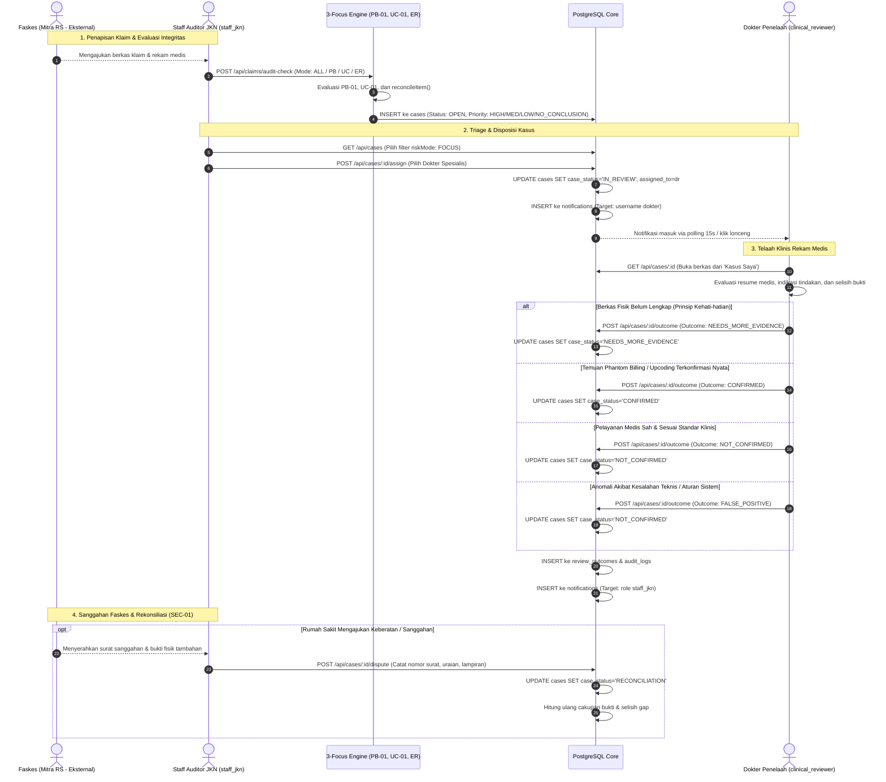

# DOKUMENTASI PROSES BISNIS DAN WORKFLOW (BPMN-INSPIRED) MEDCAREJKN

Dokumen ini menjelaskan alur proses bisnis end-to-end, pembagian tanggung jawab peran (*swimlanes*), mesin transisi status (*Finite State Machine*), serta penanganan sengketa (*dispute workflow*) pada platform **medCareJKN** yang berfokus secara eksklusif pada **Tiga Domain Utama: Phantom Billing, Upcoding, dan Evidence Review** per **30 Oktober 2026**.

---

## 1. PENDAHULUAN & TUJUAN SISTEM

**medCareJKN** adalah sistem otomasi audit integritas klaim jaminan kesehatan nasional yang dirancang untuk mendeteksi potensi tagihan fiktif (*phantom billing*), manipulasi kenaikan tarif (*upcoding*), serta verifikasi kesesuaian dokumen bukti medis (*evidence review*).

> [!NOTE]
> **Klarifikasi Notasi Diagram & Metode Verifikasi:** Diagram dalam dokumen ini merupakan **representasi visual proses bisnis berorientasi BPMN (*BPMN-Inspired Business Process Representation*)** yang dirender menggunakan Mermaid `flowchart LR` dan `sequenceDiagram`. Diagram ini bertujuan memvisualisasikan interaksi antar-peran, pembagian tanggung jawab (*swimlanes*), dan pertukaran pesan secara intuitif, **bukan notasi formal standar XML BPMN 2.0**.
> 
> *Catatan Verifikasi Parser Mermaid:* Pemeriksaan seluruh diagram dalam dokumen ini dilakukan melalui penelusuran sintaks dan struktur blok kode teks Markdown. Di lingkungan komputer lokal Windows saat ini, utilitas parser Mermaid CLI (`mmdc`) tidak tersedia dan tidak dipasang dependensi eksternal baru.

### Prinsip Utama Sistem 3 Fokus:
1. **Rule Engine Deterministik (`rules-1.0.0`):** Deteksi risiko dihitung secara transparan berbasis aturan terstruktur:
   - **Phantom Billing (PB-01):** Kuantitas klaim tertagih melebihi bukti layanan fisik yang sah (Bobot: **65**).
   - **Upcoding (UC-01):** Nominal klaim tertagih melebihi acuan standar tarif INA-CBG (Bobot: **35**).
   - **Evidence Review (Rekonsiliasi Deterministik):** Menggunakan fungsi `reconcileItem()` (`shared/evidenceReconciliation.js`) untuk rekonsiliasi objektif bukti vs butir tindakan tanpa penambahan bobot fraud artifisial (Bobot: **0**).
2. **Pemisahan Tegas Ketiadaan Bukti vs Fraud:** Berkas dengan ketiadaan bukti fisik (`evidenceAvailable === false`) diberi status **`primary_risk_mode = 'UNAVAILABLE'`**, **`review_priority = 'NO_CONCLUSION'`**, dan **`risk_score = 0`**. Sistem tidak pernah mengasumsikan ketiadaan dokumen secara otomatis sebagai kejahatan fraud.
3. **Kolaborasi Multi-Role:** Mengintegrasikan **Staff Auditor JKN** (verifikator administratif), **Dokter Penelaah Medis** (spesialis klinis independen), dan **Faskes** (entitas eksternal yang diwakili) dengan pencatatan jejak audit permanen di PostgreSQL.

---

## 2. PETA PERAN & BATASAN SWIMLANE AKTUAL (BPMN-INSPIRED)

```mermaid
flowchart LR
    subgraph External["ENTITAS EKSTERNAL (Non-Login)"]
        Faskes["Fasilitas Kesehatan / Rumah Sakit\n(Aktor Luar: Pengirim Klaim & Berkas Sanggahan)"]
    end

    subgraph Internal["SISTEM APLIKASI INTERNAL MEDCAREJKN"]
        Engine["3-Focus Rule & Reconciliation Engine\n(PB-01, UC-01, reconcileItem)"]
        Staff["Staff Auditor JKN (staff_jkn)\n(Triage Kasus, Disposisi, Catat Sanggahan Faskes)"]
        Dokter["Dokter Penelaah Klinis (clinical_reviewer)\n(Telaah Rekam Medis & Putusan Review Outcome)"]
        DB[("PostgreSQL jkn_integrity\n(Tabel cases, notifications, audit_logs)")]
    end

    Faskes -.->|Tagihan Klaim & Rekam Medis Fisik| Staff
    Faskes -.->|Surat Keberatan & Berkas Sanggahan| Staff
    Staff -->|Input Audit Klaim Manual| Engine
    Engine -->|Hasil Penapisan Risiko| DB
    DB -->|Antrean Kasus 3 Fokus (FOCUS)| Staff
    Staff -->|Disposisi Kasus| Dokter
    Dokter -->|Review Outcome Klinis| DB
    DB -.->|Notifikasi Polling 15s / On-Demand| Staff
    DB -.->|Notifikasi Polling 15s / On-Demand| Dokter
```

### Batasan Kewenangan Antar-Peran:
- **`staff_jkn` (Staff Auditor JKN):** Mengelola triage kasus, mendisposisikan penugasan dokter, mengunggah bukti medis tambahan, dan mencatat sanggahan resmi rumah sakit (dilindungi SEC-01).
- **`clinical_reviewer` (Dokter Penelaah Medis):** Menerima kasus yang ditugaskan (*assigned cases*), mengevaluasi rekam medis secara klinis, dan menetapkan putusan akhir (*Review Outcome*).
- **Fasilitas Kesehatan (Faskes):** Mitra eksternal **tanpa akun pengguna login**. Segala bentuk sanggahan dan pembuktian dicatat oleh Staff JKN atas nama rumah sakit.

---

## 3. DIAGRAM ALUR PROSES BISNIS END-TO-END (BPMN-INSPIRED)



---

## 4. MATRIKS TRANSISI STATUS KASUS (*FINITE STATE MACHINE*)

| Status Saat Ini | Aksi / Endpoint API | Status Baru | Aktor / Otorisasi Backend | Kondisi Prasyarat |
|---|---|---|---|---|
| `(BARU)` | `/claims/audit-check` | `OPEN` | Sistem / Staff JKN | Hasil audit disimpan dengan opsi `saveCase: true`. |
| `OPEN` / `NEW` | `POST /cases/:id/ownership` | `TRIAGED` | Staff JKN (`requireRole('staff_jkn')`) | Staf mengambil alih tanggung jawab berkas. |
| `OPEN` / `TRIAGED` / `NEEDS_MORE_EVIDENCE` / `RECONCILIATION` / `ESCALATED` | `POST /cases/:id/assign` | `IN_REVIEW` | Staff JKN (`requireRole('staff_jkn')`) | Dokter penelaah valid dipilih (`dr.anindya`, `dr.budi`, `dr.ratna`). Kasus belum final. Menerbitkan notifikasi penugasan. |
| `IN_REVIEW` / `RECONCILIATION` / `NEEDS_MORE_EVIDENCE` | `POST /cases/:id/outcome` (Opsi UI: `NEEDS_MORE_EVIDENCE`) | `NEEDS_MORE_EVIDENCE` | Dokter Penelaah (`requireRole('clinical_reviewer')`) | Dokumen fisik belum lengkap; meminta konfirmasi faskes tanpa memvonis fraud. |
| `IN_REVIEW` / `RECONCILIATION` / `NEEDS_MORE_EVIDENCE` | `POST /cases/:id/outcome` (Opsi UI: `CONFIRMED`) | `CONFIRMED` | Dokter Penelaah (`requireRole('clinical_reviewer')`) | Temuan Phantom Billing / Upcoding terbukti konklusif. Kasus final. |
| `IN_REVIEW` / `RECONCILIATION` / `NEEDS_MORE_EVIDENCE` | `POST /cases/:id/outcome` (Opsi UI: `NOT_CONFIRMED`) | `NOT_CONFIRMED` | Dokter Penelaah (`requireRole('clinical_reviewer')`) | Tindakan medis sah dan dapat dipertanggungjawabkan. Kasus final. |
| `IN_REVIEW` / `RECONCILIATION` / `NEEDS_MORE_EVIDENCE` | `POST /cases/:id/outcome` (Opsi UI: `FALSE_POSITIVE`) | `NOT_CONFIRMED` | Dokter Penelaah (`requireRole('clinical_reviewer')`) | Anomali akibat kekeliruan aturan. Disimpan `FALSE_POSITIVE` di `review_outcomes`, status kasus `NOT_CONFIRMED`. |
| `OPEN` / `NEW` / `TRIAGED` / `IN_REVIEW` / `NEEDS_MORE_EVIDENCE` / `ESCALATED` | `POST /cases/:id/dispute` | `RECONCILIATION` | Staff JKN (`requireRole('staff_jkn')`) | Sanggahan rumah sakit dicatat bersama lampiran berkas. |
| `RECONCILIATION` | `POST /cases/:id/dispute` | `RECONCILIATION` (Tetap) | Staff JKN (`requireRole('staff_jkn')`) | Pencatatan sanggahan tambahan/susulan. |
| `CONFIRMED` / `NOT_CONFIRMED` / `CLOSED` | `POST /cases/:id/dispute` | `RECONCILIATION` | Staff JKN (`requireRole('staff_jkn')`) | Dibuka kembali HANYA jika parameter `allowRevision === true` (literal boolean) disertakan oleh Staff JKN. |
| `NEEDS_MORE_EVIDENCE` / `RECONCILIATION` | `POST /cases/:id/evidence` | Status Tetap (Bukti Diperbarui) | Sesi Aktif (`requireSession`) | Dokumen bukti diunggah dan ditautkan ke butir tindakan; cakupan bukti dihitung ulang. |
| `CONFIRMED` / `NOT_CONFIRMED` | Penutupan administrasi | `CLOSED` | Staff JKN | Berkas audit dinyatakan selesai secara administratif. |

---

## 5. ALUR PENANGANAN SENGKETA (*DISPUTE WORKFLOW*) & PROTEKSI SEC-01

1. **Penerimaan Sanggahan Eksternal:** Faskes menyerahkan surat keberatan dan rekam medis fisik kepada cabang BPJS Kesehatan.
2. **Pencatatan Resmi oleh Staff JKN:** Staff JKN membuka Bagian 7B pada berkas kasus, menginput nomor surat, pokok argumentasi, dan mengunggah dokumen PDF lampiran faskes.
3. **Perlindungan SEC-01 pada Kasus Final:**
   - Kasus berstatus final (`CONFIRMED`, `NOT_CONFIRMED`, `CLOSED`) terkunci dari modifikasi langsung.
   - Pembukaan kembali status menjadi `RECONCILIATION` mewajibkan otorisasi peran `staff_jkn` dan parameter strict boolean `allowRevision === true`.
   - Permintaan sanggahan dari dokter (`clinical_reviewer`) ditolak seketika dengan HTTP 403 Forbidden.
   - Nilai truthy non-boolean (`"true"`, `1`, `{}`) ditolak tegas dengan HTTP 409 Conflict.
4. **Penelaahan Ulang Bersama DPJP:** Status kasus bertransisi menjadi `RECONCILIATION`, memungkinkan Dokter Penelaah meninjau bukti baru dan memperbarui keputusan telaah klinis secara objektif dan berimbang.
