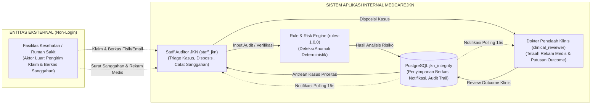
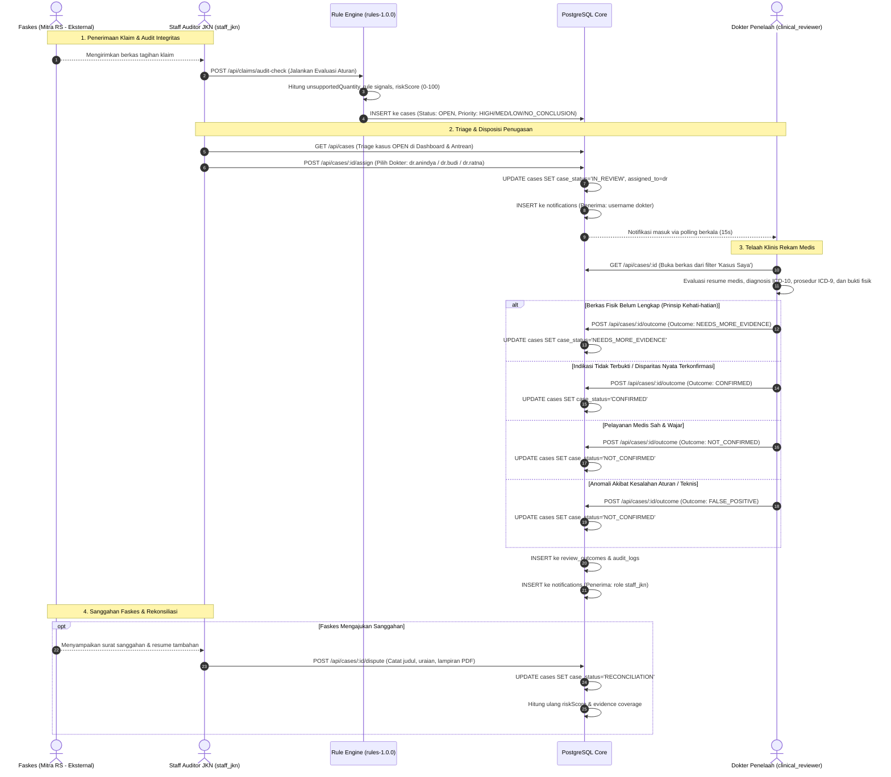

# DOKUMENTASI PROSES BISNIS DAN WORKFLOW (BPMN-INSPIRED) MEDCAREJKN

## 1. PENDAHULUAN & TUJUAN SISTEM

**medCareJKN** adalah sistem otomasi audit integritas klaim jaminan kesehatan nasional yang dirancang untuk mendeteksi potensi tagihan fiktif (*phantom billing*), peningkatan tarif/kelas layanan (*upcoding*), prosedur yang tidak perlu (*unnecessary procedures*), klaim ganda (*duplicate claim*), serta ketidaksesuaian dokumen medis pendukung.

> [!NOTE]
> **Klarifikasi Notasi Diagram & Metode Verifikasi:** Diagram dalam dokumen ini merupakan **representasi visual proses bisnis berorientasi BPMN (*BPMN-Inspired Business Process Representation*)** yang dirender menggunakan Mermaid `flowchart LR` dan `sequenceDiagram`. Diagram ini bertujuan memvisualisasikan interaksi antar-peran, pembagian tanggung jawab (*swimlanes*), dan pertukaran pesan secara intuitif, **bukan notasi formal standar XML BPMN 2.0 lengkap**.
> 
> *Catatan Verifikasi Parser Mermaid:* Pemeriksaan seluruh diagram dalam dokumen ini dilakukan melalui inspeksi teks dan struktur blok sintaks Markdown. Di lingkungan komputer lokal saat ini, parser Mermaid CLI (`mmdc`) tidak tersedia dan tidak diizinkan memasang dependensi baru atau mengakses jaringan. Oleh karena itu, rendering visual aktual melalui mesin parser belum diverifikasi secara terprogram dan tidak dapat disimpulkan semata-mata dari inspeksi kode teks.

### Prinsip Utama Sistem (Berdasarkan Sumber Kode Aktual):
1. **Rule Engine Deterministik (`rules-1.0.0`):** Deteksi risiko dihitung secara transparan berbasis aturan terstruktur (*explainable rule weights*), **bukan model ML kotak-hitam (black-box)** dan **bukan probabilitas fraud**.
2. **Pemisahan Ketiadaan Bukti vs Fraud:** Ketiadaan berkas pendukung (*EVIDENCE-MISSING*) diperlakukan sebagai **"Bukti belum tersedia untuk disimpulkan"** dengan tindakan lanjut **"Minta bukti layanan, tanpa menyimpulkan fraud"**. Sistem tidak pernah mengasumsikan ketiadaan dokumen secara otomatis sebagai fraud.
3. **Penapisan Berbasis Risiko (*Risk-Based Triage*):** Mengelompokkan kasus ke dalam prioritas telaah: `HIGH` (skor $\ge 60$), `MEDIUM` (skor $\ge 30$), `LOW` (skor $< 30$), atau `NO_CONCLUSION` (jika data bukti belum lengkap dan tidak ada sinyal aturan lain).
4. **Kolaborasi Multi-Role:** Menghubungkan **Staff Auditor JKN** (verifikator administrasi) dan **Dokter Penelaah Medis** (spesialis klinis) dengan pencatatan riwayat audit di basis data PostgreSQL lokal.

---

## 2. PETA PERAN & BATASAN SWIMLANE AKTUAL (BPMN-INSPIRED)

Pemeriksaan menyeluruh terhadap basis data dan modul otentikasi (`backend/src/auth/session.js` dan `shared/users.js`) menegaskan batasan peran aktual:

### Fakta Penting Batasan Peran:
- **Role Terotentikasi:** Hanya terdapat 2 role pengguna di dalam sistem:
  1. `staff_jkn`: Verifikator administratif JKN (Ahmad Fauzi, S.E. dan Aditya Pratama, S.Kep.).
  2. `clinical_reviewer`: Dokter Penelaah Klinis (dr. Anindya Kusuma, Sp.PK; dr. Budi Santoso, Sp.A; dr. Ratna Dewi, Sp.PD).
- **Status Faskes (Rumah Sakit):** Faskes **TIDAK memiliki portal login independen** dan **TIDAK memiliki akun pengguna internal**. Faskes adalah **aktor bisnis eksternal**. Interaksi sanggahan Faskes dicatat ke dalam sistem oleh Staff JKN melalui modul internal *Rekonsiliasi Sanggahan* pada halaman detail kasus.

---

## 3. DIAGRAM ALUR PROSES BISNIS END-TO-END (BPMN-INSPIRED)

---

## 4. MATRIKS TRANSISI STATUS KASUS (*FINITE STATE MACHINE*)

Berdasarkan implementasi pada `backend/src/services/caseService.js`, kasus klaim memiliki daur hidup status yang terkontrol:

| Status Saat Ini | Aksi / Endpoint API | Status Baru | Aktor / Otorisasi Backend | Kondisi Prasyarat |
|---|---|---|---|---|
| `(BARU)` | `/claims/audit-check` | `OPEN` | Sistem / Staff JKN | Hasil audit disimpan dengan opsi `saveCase: true`. |
| `OPEN` / `NEW` | `POST /cases/:id/ownership` | `TRIAGED` | Staff JKN (`requireRole('staff_jkn')`) | Staf mengambil alih tanggung jawab berkas. |
| `OPEN` / `TRIAGED` / `NEEDS_MORE_EVIDENCE` / `RECONCILIATION` / `ESCALATED` | `POST /cases/:id/assign` | `IN_REVIEW` | Staff JKN (`requireRole('staff_jkn')`) | Dokter penelaah valid dipilih (`dr.anindya`, `dr.budi`, `dr.ratna`). Kasus belum berstatus final. Menerima status asal `ESCALATED`, menimpa reviewer sebelumnya, dan menerbitkan notifikasi penugasan. |
| `IN_REVIEW` / `RECONCILIATION` / `NEEDS_MORE_EVIDENCE` | `POST /cases/:id/outcome` (Opsi UI: `NEEDS_MORE_EVIDENCE`) | `NEEDS_MORE_EVIDENCE` | Dokter Penelaah (`requireRole('clinical_reviewer')`) | Berkas fisik pendukung belum lengkap untuk menarik kesimpulan klinis. Dokter wajib tercatat sebagai `assigned_to` pada berkas kasus. |
| `IN_REVIEW` / `RECONCILIATION` / `NEEDS_MORE_EVIDENCE` | `POST /cases/:id/outcome` (Opsi UI: `CONFIRMED`) | `CONFIRMED` | Dokter Penelaah (`requireRole('clinical_reviewer')`) | Dokter yang ditugaskan mencatat alasan klinis konfirmasi temuan. Nilai mentah `CONFIRMED` disimpan di `review_outcomes`. |
| `IN_REVIEW` / `RECONCILIATION` / `NEEDS_MORE_EVIDENCE` | `POST /cases/:id/outcome` (Opsi UI: `NOT_CONFIRMED`) | `NOT_CONFIRMED` | Dokter Penelaah (`requireRole('clinical_reviewer')`) | Dokter mencatat kesesuaian klinis. Nilai mentah `NOT_CONFIRMED` disimpan di `review_outcomes`. Klaim dinyatakan sah/wajar. |
| `IN_REVIEW` / `RECONCILIATION` / `NEEDS_MORE_EVIDENCE` | `POST /cases/:id/outcome` (Opsi UI: `FALSE_POSITIVE`) | `NOT_CONFIRMED` | Dokter Penelaah (`requireRole('clinical_reviewer')`) | Dokter mencatat anomali akibat kekeliruan aturan/sistem. Nilai mentah `FALSE_POSITIVE` disimpan di `review_outcomes`, namun status akhir pada tabel `cases` dipetakan ke `NOT_CONFIRMED`. |
| `OPEN` / `NEW` / `TRIAGED` / `IN_REVIEW` / `NEEDS_MORE_EVIDENCE` / `ESCALATED` | `POST /cases/:id/dispute` | `RECONCILIATION` | Staff JKN (`requireRole('staff_jkn')` & Service Guard) | Sanggahan dari Faskes dicatat ke sistem bersama dokumen lampiran. Kasus belum berstatus final. |
| `RECONCILIATION` | `POST /cases/:id/dispute` | `RECONCILIATION` (Tetap) | Staff JKN (`requireRole('staff_jkn')` & Service Guard) | Dokumen sanggahan tambahan/susulan dicatat ke `case_documents`, kalkulasi ulang risiko, status kasus tetap `RECONCILIATION`. |
| `CONFIRMED` / `NOT_CONFIRMED` / `CLOSED` | `POST /cases/:id/dispute` | `RECONCILIATION` | Staff JKN (`requireRole('staff_jkn')` & Service Guard) | Sanggahan pasca-putusan final diproses jika parameter `allowRevision: true` disertakan oleh Staff JKN yang sah. |
| `NEEDS_MORE_EVIDENCE` / `RECONCILIATION` | `POST /cases/:id/evidence` | Status Kasus Tetap (Bukti Diperbarui) | Sesi Pengguna Aktif (`requireSession`) | Bukti baru ditautkan ke butir tindakan; cakupan bukti (*evidence coverage*) dihitung ulang. |
| `IN_REVIEW` / `RECONCILIATION` / `NEEDS_MORE_EVIDENCE` | `POST /cases/:id/outcome` (Direct API: `ESCALATED`) | `ESCALATED` | Dokter Penelaah (`requireRole('clinical_reviewer')`) | Diterima sah di backend API (`POST /cases/:id/outcome`), namun tidak tersedia kartu pilihan pada UI dokter `CaseDetailPage.jsx`. |
| `CONFIRMED` / `NOT_CONFIRMED` | Penutupan administrasi | `CLOSED` | Staff JKN | Finalisasi berkas klaim tuntas. |

### Pemetaan 3-Lapis Outcome Telaah Klinis (UI vs Backend API vs Status Kasus Database)

| Pilihan pada UI Form Dokter (`CaseDetailPage.jsx`) | Nilai Diterima API Backend (`outcome`) | Disimpan di Kolom `review_outcomes.outcome` | Status Akhir pada Kolom `cases.case_status` | Keterangan & Karakteristik Status |
|---|---|---|---|---|
| `CONFIRMED` ("Temuan terkonfirmasi oleh reviewer") | `CONFIRMED` | `CONFIRMED` | `CONFIRMED` | Disparitas/fraud terbukti konklusif. Kasus final. |
| `NOT_CONFIRMED` ("Klaim Wajar (Valid)") | `NOT_CONFIRMED` | `NOT_CONFIRMED` | `NOT_CONFIRMED` | Tindakan sah dan dapat dipertanggungjawabkan medis. Kasus final. |
| `FALSE_POSITIVE` ("False Positive") | `FALSE_POSITIVE` | `FALSE_POSITIVE` | `NOT_CONFIRMED` | **PENTING:** Backend menerima dan menyimpan nilai mentah `FALSE_POSITIVE` di tabel `review_outcomes`, namun memetakan kolom `cases.case_status` menjadi `NOT_CONFIRMED` (`caseService.js` baris 262-264). Kasus final. |
| `NEEDS_MORE_EVIDENCE` ("Perlu Konfirmasi Berkas") | `NEEDS_MORE_EVIDENCE` | `NEEDS_MORE_EVIDENCE` | `NEEDS_MORE_EVIDENCE` | Bukti fisik belum lengkap; meminta berkas konfirmasi resmi. Kasus non-final. |
| *(Tidak ada kartu opsi pada formulir UI dokter)* | `ESCALATED` | `ESCALATED` | `ESCALATED` | Diterima oleh backend API dan tersedia sebagai filter antrean pada `CasesPage.jsx`. |

> [!NOTE]
> **Resolusi Temuan Keamanan Otorisasi Endpoint Dispute (SEC-01 — RESOLVED & VERIFIED):**
> 1. **Perlindungan Route Backend:** Endpoint `POST /api/cases/:caseId/dispute` pada [backend/src/routes/caseRoutes.js](file:///D:/medcare/backend/src/routes/caseRoutes.js#L18) dilindungi middleware `requireRole('staff_jkn')`.
> 2. **Perlindungan Service (*Defense in Depth*):** Method `recordCaseAction('dispute')` di [backend/src/services/caseService.js](file:///D:/medcare/backend/src/services/caseService.js#L368) memverifikasi bahwa pemanggil ber-role `staff_jkn` sebelum memeriksa status kasus atau parameter revisi.
> 3. **Perlindungan `allowRevision`:** Role selain `staff_jkn` (seperti `clinical_reviewer`) ditolak langsung dengan status HTTP 403, sehingga parameter `allowRevision: true` tidak dapat disalahgunakan untuk membuka kembali kasus final.
> 4. **Konsistensi UI:** Tombol aksi dan modal sanggahan pada antarmuka frontend `CaseDetailPage.jsx` hanya ditampilkan untuk akun Staff JKN.
> 5. **Verifikasi Test Otomatis:** Telah teruji dan lulus 100% pada suite pengujian [backend/tests/security.dispute.test.js](file:///D:/medcare/backend/tests/security.dispute.test.js).

> [!NOTE]
> **Pembedaan Tata Kelola / SOP Medis vs Validasi Teknis Backend pada Kasus `RECONCILIATION`:**
> 1. **Pemeriksaan Teknis Backend (`submitCaseOutcome`):** Fungsi penyimpanan keputusan klinis di `caseService.js` (baris 230-310) hanya memeriksa: (a) status kasus saat ini bukan status final (kasus berstatus final langsung ditolak dengan HTTP 409), (b) pemanggil adalah dokter yang ditugaskan (`currentCase.assigned_to === reviewerId`), (c) format dan enum putusan valid (`CONFIRMED`, `NOT_CONFIRMED`, `NEEDS_MORE_EVIDENCE`, `ESCALATED`), dan (d) catatan telaah klinis (`notes`) tidak kosong. Karena status `RECONCILIATION` bukan status final, validasi status lolos secara teknis. Backend **tidak memeriksa secara teknis** apakah dokumen sanggahan baru sudah dibuka/dibaca, apakah bukti baru sudah dilampirkan, atau apakah telaah ulang dokter sudah tuntas dilakukan.
> 2. **Panduan Tata Kelola / SOP Medis:** Dalam alur operasional medis BPJS Kesehatan, dokter penelaah diwajibkan menelaah dokumen sanggahan Faskes dan bukti tambahan secara seksama sebelum menimpa atau memperbarui putusan klinis. Ini merupakan kepatuhan SOP tata kelola medis, bukan *hard-guard* teknis pada kode backend.

> [!NOTE]
> **Status `ESCALATED` (Hasil Rekonsiliasi Backend vs Antarmuka Pengguna & Kalibrasi Pengujian):**
> - **Dukungan API Backend:** `ESCALATED` didukung secara sah pada backend API via `submitCaseOutcome` (`outcome === 'ESCALATED'`) dan diizinkan sebagai status asal pada mutasi sanggahan `recordCaseAction('dispute')` serta penugasan verifikator `assignCaseReviewer`.
> - **Antarmuka Pengguna (UI):** Form telaah klinis di `CaseDetailPage.jsx` hanya menyediakan 4 kartu pilihan keputusan (`NEEDS_MORE_EVIDENCE`, `CONFIRMED`, `NOT_CONFIRMED`, `FALSE_POSITIVE`). Namun, dropdown filter status antrean kasus (`CasesPage.jsx` baris 376) tetap menyediakan opsi `<option value="ESCALATED">ESCALATED</option>`.
> - **Kalibrasi Pengujian Runtime:** Dukungan transisi sanggahan (`dispute`) dan penugasan ulang dokter (`assign`) dari status `ESCALATED` didasarkan pada **analisis inspeksi kode struktural backend secara baca-saja** (tidak adanya guard pemblokir status `ESCALATED` pada `caseService.js`). Tidak ada kasus dalam seed data yang berstatus `ESCALATED`, sehingga transisi ini **belum diuji secara runtime**. Dokumentasi membatasi diri pada klaim dukungan struktural kode tanpa menjamin kelancaran eksekusi end-to-end tanpa pengujian live.

> [!NOTE]
> **Status `NEW` pada Siklus Kasus:**
> Status `NEW` secara aktif digunakan untuk kasus agregat pola anomali (`case_type = 'pattern'`) yang diinisialisasi melalui endpoint `POST /anomalies/cases` di [backend/src/routes/bpjsRoutes.js](file:///D:/medcare/backend/src/routes/bpjsRoutes.js#L12). Ketika verifikator mengambil alih tanggung jawab berkas pola ini melalui endpoint `POST /cases/:id/ownership`, statusnya bertransisi dari `NEW` menjadi `TRIAGED`.

> [!IMPORTANT]
> **Kekebalan Status Final & Jalur Pengecualian Revisi:**
> 1. Jika kasus telah berstatus final (`CONFIRMED`, `NOT_CONFIRMED`, atau `CLOSED`), sistem backend secara baku menolak mutasi penugasan maupun penambahan dokumen bukti/sanggahan dengan galat `409 Conflict: Kasus sudah diputuskan`.
> 2. Pengecualian revisi dibuka melalui parameter eksplisit `allowRevision: true` pada aksi sanggahan (`POST /cases/:id/dispute`), yang mengubah status berkas final kembali ke `RECONCILIATION`.
> 3. Pembukaan jalur rekonsiliasi ini **tidak serta-merta mengizinkan penimpaan langsung keputusan klinis**, melainkan mengalirkan berkas ke tahap penelaahan ulang dokumen sanggahan rumah sakit sebelum putusan baru dapat ditetapkan.

---

## 5. REKONSILIASI SANGGAHAN FASKES (*DISPUTE WORKFLOW*)

Sanggahan dari Fasilitas Kesehatan merupakan bagian penting dari tata kelola audit JKN:

### A. Pembedaan Tiga Entitas Terlibat
1. **Pihak yang Diwakili (*Represented Entity*):** Fasilitas Kesehatan (Rumah Sakit / Komite Medik RS). Faskes **tidak memiliki akun pengguna mandiri maupun portal login independen** ke dalam aplikasi MedCareJKN.
2. **Pengguna Pencatat (*Recording User*):** Staff JKN internal yang memegang sesi login aktif, yang menginput surat keberatan fisik/email resmi dari Faskes ke dalam sistem melalui Seksi 7B `CaseDetailPage.jsx`.
3. **Dokter Penelaah (*Clinical Reviewer*):** Dokter Spesialis (DPJP) yang ditugaskan untuk mengevaluasi dasar medis sanggahan dan menetapkan putusan klinis baru.

### B. Tahapan Alur Sanggahan
1. **Penerimaan Sanggahan Eksternal:** Rumah Sakit menyerahkan Berita Acara Keberatan / Surat Klarifikasi beserta dokumen rekam medis pendukung kepada kantor cabang BPJS Kesehatan.
2. **Pencatatan Internal oleh Staff:** Staff JKN membuka berkas kasus, menuju ke **Bagian 7B: Rekonsiliasi Sanggahan Faskes**, lalu menginput:
   - Nomor surat keberatan dan tanggal.
   - Poin keberatan medis rumah sakit.
   - Mengunggah file PDF/gambar dokumen lampiran (maksimal 10 MB, ekstensi `.pdf`, `.jpg`, `.jpeg`, `.png`).
3. **Efek Sistem & Penyimpanan Database:**
   - Status kasus otomatis bertransisi menjadi `RECONCILIATION`.
   - Tabel `case_documents` mencatat rekaman jenis `dispute` dengan kolom `actor` diisi username staf pencatat (`actor.username`), sementara teks argumentasi, nama perwakilan Faskes, dan badge role (`'Fasilitas Kesehatan (Rumah Sakit)'`) disimpan di dalam kolom JSON `payload`.
   - Tabel `audit_logs` merekam aksi `DISPUTE_SUBMITTED` dengan `actor_id` diisi username staf, dan rincian payload dimasukkan ke dalam JSON kolom `detail`.
   - Sistem secara otomatis menghitung ulang *Evidence Coverage* dan *Risk Score* jika bukti baru diverifikasi.
   - Sinyal notifikasi otomatis dikirimkan ke Staff JKN dan Dokter Penelaah kasus tersebut via polling berkala.
4. **Evaluasi Putusan Akhir:** Dokter Penelaah memeriksa kembali dokumen sanggahan dan memperbarui putusan telaah klinis (*Review Outcome*).

> [!NOTE]
> **Keterbatasan Implementasi Penyimpanan Identitas Aktor Sanggahan:**
> Skema database saat ini belum menyediakan kolom terpisah antara pengguna pencatat (*recorded_by_user*) dan entitas Faskes yang diwakili (*representing_entity*). Selain itu, fungsi `getCaseDetail` di backend menimpa properti `actor` dengan username staf pencatat (`actor: d.actor`), sehingga pada tampilan UI nama yang muncul di samping badge role `'Fasilitas Kesehatan (Rumah Sakit)'` adalah username staf pencatat (misal `staff.ahmad`). Keterbatasan ini dicatat dalam dokumentasi tanpa memodifikasi kode sumber.

---

## 6. BATASAN LINGKUP & ISOLASI DATASET

Untuk menjamin kepatuhan audit dan validitas pengujian, data dalam MedCareJKN dibagi secara tegas:
1. **Kasus Skenario Demo Sintetis (`data/demo/cases.json`):**
   - 8 kasus terkalibrasi (`CASE-PB-001` s/d `CASE-PB-008`) dengan data status `SYNTHETIC`.
   - Meliputi ragam skenario: *Phantom Billing, Upcoding, Duplicate Claim, Unnecessary Procedures*.
2. **Dataset Benchmark Sintetis (`data/benchmark/synthetic.json`):**
   - 800 skenario sintetis (560 train / 240 test) untuk evaluasi performa aturan pada `validation_report.json`.
   - Berisi peringatan resmi: *"Label berasal dari skenario sintetis. Tidak mencerminkan akurasi deteksi fraud pada data JKN nyata. trainingUsed: false"*.
3. **Sampel Kohort BPJS 2025 (`outputs/bpjs-2025/`):**
   - Sampel data kontekstual COVID edisi 2025 yang telah dide-identifikasi dan diagregasikan.
   - Dibaca secara *read-only* melalui SQLite `bpjs-patients.sqlite` dan `analysis.json` untuk visualisasi distribusi dan katalog klaim tanpa mengekspos NIK pasien riil.
